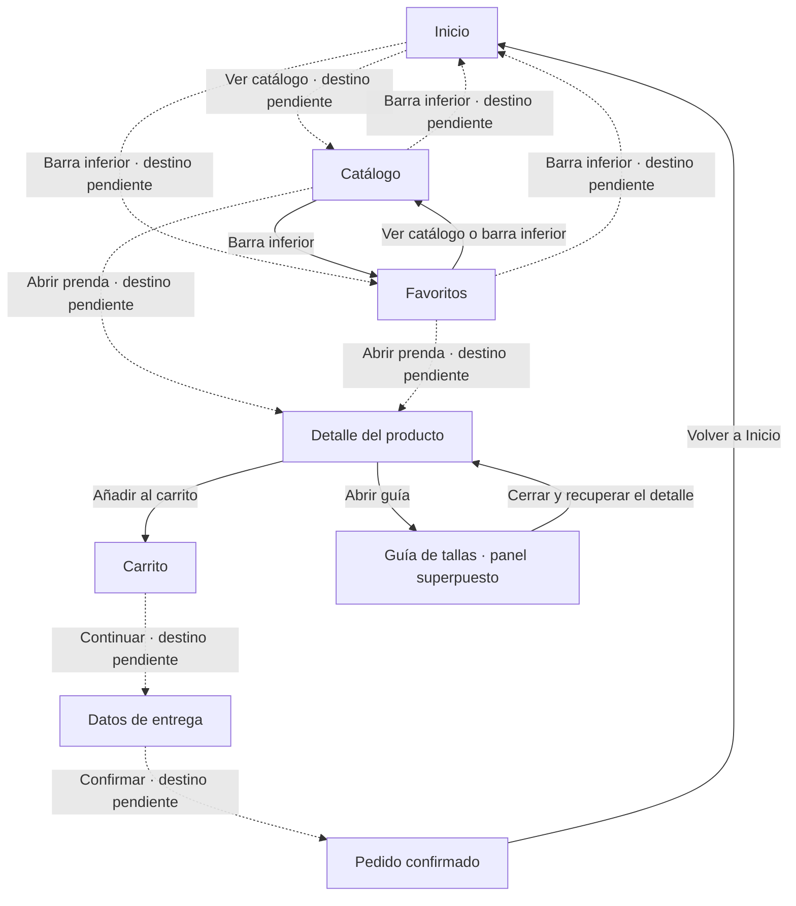

# Documentación de la interfaz · Pequeño Davante

## 1. Justificación del diseño

### 1.1 Importancia del diseño centrado en el usuario

Al plantear la app de Pequeño Davante, me he centrado en cómo la usaría alguien que entra a comprar ropa infantil desde el móvil. Muchas veces será una madre, un padre o un familiar que tiene poco tiempo y mira la tienda mientras hace otra cosa. Por eso he intentado que las opciones principales se vean sin tener que ir abriendo menús.

Una de las cosas que más dudas puede dar es la talla. Saber los años que tiene un niño no siempre sirve para acertar con la ropa. He dejado la guía en la propia ficha, al lado del selector de talla, para poder consultarla sin salir de la prenda. Las tallas sin stock tienen un estado distinto para no confundirlas con las disponibles.

El botón de añadir al carrito está en la parte baja de la pantalla para tenerlo más a mano. En el carrito aparecen la cantidad y el importe, y en el formulario de entrega hay un ejemplo de email incorrecto con un mensaje de ayuda. Me interesa que se entienda qué hay que hacer en cada paso y cómo corregir un error.

### 1.2 Objetivos y metas del proyecto

Para comprobar si el diseño se entiende, he marcado cuatro objetivos. Los tres primeros se medirán en las pruebas con al menos dos compañeros de otro grupo. El último se comprobará con los colores de la guía de estilo.

- Completar la compra de la chaqueta en verde oliva, talla 4 y cantidad 2 en menos de dos minutos y sin ayuda. Contaré desde Inicio hasta Confirmación. Es el recorrido que quiero probar cuando estén resueltas las conexiones pendientes del apartado 3.1.
- Encontrar y abrir la guía de tallas desde el detalle en menos de diez segundos, sin indicar dónde está. Apuntaré si la encuentran a la primera o si antes pulsan en otro sitio.
- Corregir el error de email y continuar desde Entrega sin ayuda. Mediré el tiempo y los intentos fallidos para ver si el mensaje explica bien qué hay que cambiar.
- Revisar que todas las parejas de color y texto de la guía tengan un contraste mínimo de 4,5 a 1, tanto en claro como en oscuro. Los valores quedarán en el apartado 3.3.

Son objetivos para las pruebas, no resultados que ya haya conseguido. Como participarán pocos compañeros, recogeré lo que le ocurra a cada uno sin sacar porcentajes sobre todos los posibles clientes.

### 1.3 Beneficios esperados

Para quien compra, la idea es poder consultar la talla, ver el precio y revisar la cantidad sin ir saltando entre pantallas. Si el formulario explica qué dato está mal, debería ser más fácil corregirlo y seguir con la compra.

Para la tienda, una guía de tallas clara podría evitar algunas dudas y compras equivocadas. Un proceso fácil de seguir podría ayudar a que menos personas dejen el carrito a medias. De momento son beneficios que espero del diseño. Para saber si bajan las devoluciones o suben las ventas haría falta probar la app con clientes reales.

## 2. Investigación y análisis de usuarios

### 2.1 Datos demográficos y segmentación

Pequeño Davante está pensada para personas adultas que compran ropa y calzado para niños de 0 a 14 años desde un móvil Android. Quien usa la app y decide la compra no tiene por qué ser quien va a llevar la prenda. Esto importa sobre todo al hacer un regalo, porque se puede conocer la edad del niño sin saber su talla.

He dividido el público en tres grupos según la situación de compra. Las edades son orientativas y me sirven para plantear los perfiles, no salen de una encuesta.

| Grupo | Situación de compra | Qué necesita resolver | Qué debo tener en cuenta en el diseño |
| --- | --- | --- | --- |
| Padres y madres, aproximadamente de 30 a 45 años | Reponen ropa que se ha quedado pequeña o buscan prendas para otra temporada. Pueden consultar el catálogo en ratos cortos. | Localizar una prenda, comprobar la talla y revisar el importe antes de terminar. | Categorías visibles, precio junto a la prenda y controles de cantidad en el carrito. |
| Familiares y amigos, aproximadamente de 20 a 30 años | Compran un regalo de forma puntual y pueden tener poca información sobre las medidas del niño. | Entender las tallas y completar la compra sin tener que crear una cuenta. | Guía de tallas accesible desde el detalle y recorrido de compra sin un paso de registro. |
| Abuelos y otros familiares, aproximadamente de 60 a 75 años | Buscan una prenda para un nieto y pueden preferir revisar cada paso antes de confirmar. | Leer los datos con comodidad, reconocer las acciones y corregir una equivocación. | Texto con contraste, botones con etiqueta, áreas táctiles amplias y opción de deshacer al eliminar. |

La edad no dice por sí sola cómo usa alguien el móvil. Una persona joven puede perderse con las tallas y una persona mayor puede comprar online sin problemas. Me he fijado en lo que necesita resolver cada perfil.

El poco tiempo y el uso con una mano vienen del enunciado. Las pruebas con compañeros servirán para ver dónde se atascan al usar el prototipo. No sustituyen una investigación con los clientes de la tienda.

### 2.2 Personas

He creado tres perfiles para tener en cuenta distintas formas de comprar. Son personajes inventados para la actividad, no personas a las que haya entrevistado.

#### Persona 1 · Laura, 36 años

- Laura tiene dos hijos y suele encargarse de comprarles la ropa. Mira la tienda por la noche, cuando tiene un rato, y a veces deja una compra a medias.
- Quiere encontrar una chaqueta, comprobar si queda su talla y ver cuánto cuestan dos unidades.
- Le molesta entrar en una prenda y descubrir después que no hay stock. Si deja la compra para otro día, quiere poder volver a lo que le había gustado.
- Para ella he tenido en cuenta el precio visible en el catálogo, los estados de talla y Favoritos. El carrito reúne los controles de cantidad y el importe. El guardado de favoritos entre sesiones quedaría para una app real.

#### Persona 2 · David, 25 años

- David busca un regalo para su sobrino. Sabe los años que tiene, pero no conoce sus medidas ni suele comprar ropa infantil.
- Quiere entender qué talla elegir y comprar sin tener que crear una cuenta.
- Le cuesta decidir si la talla aparece solo como un número. Tampoco quiere perder la ficha de la prenda al abrir la ayuda.
- Por eso la guía se abre sobre el detalle y permite volver a la misma prenda al cerrarla. El recorrido está planteado sin un paso de registro. El archivo definitivo no tiene login ni un sistema de cuentas.

#### Persona 3 · Alberto, 68 años

- Alberto quiere comprarle una prenda a su nieta. Usa el móvil para mensajes y algunas compras, pero prefiere ir despacio cuando no conoce una pantalla. Para este perfil he supuesto que necesita la letra más grande.
- Quiere leer bien el precio, elegir la talla y comprobar que no ha añadido algo de más.
- Le frustra no entender un icono o borrar un producto sin saber cómo recuperarlo.
- Para él he tenido en cuenta las etiquetas de los botones, el contraste y las áreas táctiles. La recuperación con Deshacer queda pendiente de comprobar. Como los frames tienen un tamaño fijo, tampoco se puede probar aquí qué pasaría al aumentar la letra desde los ajustes de Android.

### 2.3 Análisis de la competencia

He revisado las webs y la ayuda en español de cuatro tiendas. Me he fijado sobre todo en las tallas y en los pasos para comprar, porque son las dudas que aparecen en los perfiles. La tabla separa lo que he podido comprobar de lo que yo cambiaría para Pequeño Davante. No he hecho compras ni probado sus apps Android.

| Tienda y fuente | Qué hace bien | Qué veo mejorable o qué límite encuentro | Registro y acceso comprobado | Qué me llevo para Pequeño Davante |
| --- | --- | --- | --- | --- |
| [Mayoral, ficha de una camiseta infantil](https://www.mayoral.com/es/es/camiseta-volante-nina-anis-2603008074-5) | Reúne fotos, precio, opciones de color, selección de talla y acceso a la guía en la ficha. | La descripción combina información de la prenda con una explicación sobre el algodón. Para una consulta rápida, prefiero separar la selección de compra de ese contenido adicional. | La ficha se puede consultar públicamente. Esta revisión no confirma si el pago exige una cuenta. | Mantener foto, precio, talla y guía en el mismo detalle, con la acción de compra fácil de localizar. |
| [Vertbaudet, guía de calzado](https://www.vertbaudet.es/page/asesoramiento/guias/calzado.htm) | Explica cómo medir el pie e incluye una calculadora que parte de su longitud en milímetros. Da una referencia más concreta que la edad. | La guía reúne muchos consejos por etapas. Para consultar una medida mientras elijo una prenda, prefiero una ayuda más breve y centrada en esa duda. | La guía es pública. La página ofrece acceso a una cuenta, pero eso no demuestra que el registro sea obligatorio para comprar. | Usar medidas y una explicación visual en la guía. Abrirla como panel sobre el detalle para poder volver a la prenda al cerrarla. |
| [Kiabi, ayuda para hacer un pedido](https://www.kiabi.es/servicios/pedido.html) | Explica la compra como invitado, la confirmación por email y el seguimiento sin cuenta. | El invitado no tiene el seguimiento desde una cuenta ni las ventajas de fidelidad. Me parece un límite que conviene explicar al elegir cómo comprar. | Confirma que se puede continuar sin cuenta. Por tanto, no corresponde describir su registro como obligatorio. | Dejar el inicio de sesión como opción. Para una futura app, explicar qué se guarda con una cuenta antes de pedir que se cree. |
| [Zara, centro de ayuda en España](https://www.zara.com/es/es/help/compra-segura-h28.html) | Separa los temas de tallas, favoritos, pedidos y devoluciones en grupos reconocibles. | La ayuda cubre muchos servicios de la marca. Para resolver una duda concreta sobre una talla, prefiero ofrecer un acceso desde la propia prenda sin obligar a buscar entre todos los temas. | El índice de ayuda es público y contiene un apartado de registro. El índice por sí solo no permite confirmar las condiciones de compra sin cuenta. | Mantener la guía junto al selector de talla y los destinos principales visibles en la navegación inferior. |

De estas tiendas me quedo con la ayuda cerca de la talla y con no pedir una cuenta antes de mirar las prendas. En Pequeño Davante he intentado que la ficha y el carrito tengan la información necesaria para decidir sin llenarlos de opciones.

Fuentes consultadas el 15 de octubre de 2026. Los enlaces quedan guardados en FUENTES.md para preparar las referencias del apartado 6.

### 2.4 Insights y hallazgos clave

Del enunciado, los perfiles y la comparativa he sacado estas seis ideas. Cada una tiene una decisión de diseño y una forma de comprobarla. Las pruebas con compañeros todavía están pendientes.

| Idea que orienta el diseño | De dónde sale | Decisión en Pequeño Davante | Cómo comprobarla |
| --- | --- | --- | --- |
| Conocer la edad del niño no resuelve por sí solo la elección de talla. | La duda con las tallas aparece en el enunciado y en el perfil de David. Vertbaudet muestra una ayuda basada en medidas. | Poner la guía junto al selector de talla y abrirla como panel sobre el detalle. | Pedir que consulten la guía y registrar si la encuentran sin ayuda y cuánto tardan. |
| Una compra puede interrumpirse antes de tomar una decisión. | Es una situación prevista en el perfil de Laura, no una frecuencia medida. | Incluir Favoritos como destino de la navegación inferior para poder volver a las prendas mostradas allí. | Comprobar si localizan Favoritos y vuelven al detalle. La persistencia después de cerrar la app queda fuera del prototipo. |
| Eliminar una prenda por error no debería obligar a buscarla otra vez. | El perfil de Alberto plantea dudas al tocar acciones que cambian la compra. | Prever Deshacer en el aviso de eliminación del carrito. Su funcionamiento en el archivo definitivo queda pendiente de comprobación. | Cuando se compruebe la interacción, observar si la persona reconoce la acción y recupera el producto. Puede ser una tarea adicional a las tres principales. |
| Pedir una cuenta puede añadir un paso que no necesita quien compra de forma puntual. | Necesidad planteada para David y existencia de compra como invitado en Kiabi. | Plantear el recorrido sin un paso de registro. El archivo definitivo no tiene pantalla de inicio de sesión. | Revisar el recorrido cuando estén resueltas las conexiones pendientes. La ausencia de una pantalla de acceso no equivale a tener un sistema de compra como invitado implementado. |
| Un error de formulario necesita explicar qué corregir. | Objetivo de evitar bloqueos en Entrega y necesidad de Alberto de entender cómo seguir. | Mostrar el email en estado de error con un mensaje de ayuda en el propio campo. | Pedir que corrijan el error y medir tiempo, intentos y necesidad de ayuda. |
| Antes de confirmar conviene poder relacionar la cantidad con el importe. | Laura quiere comprar dos unidades y revisar el coste. | Mantener los controles de cantidad y el resumen juntos en el carrito. Dos chaquetas de 39 € deberían dar un total de 78 €. Es un resultado esperado que habrá que comprobar, no un estado acreditado en esta revisión. | Comprobar si identifican la cantidad y el total durante la tarea de compra. |

Si en las pruebas alguien no encuentra la guía o no entiende una acción, usaré ese problema para decidir qué mejorar.

## 3. Diseño de la interfaz
### 3.1 Mapa de navegación

He organizado la compra alrededor de siete pantallas. Inicio presenta la tienda, Catálogo permite ver las prendas y Detalle reúne la información para elegir. Después están Carrito, Datos de entrega y Pedido confirmado. Favoritos permite volver a las prendas mostradas como guardadas.

El mapa recoge la estructura prevista y el estado de las conexiones en el archivo definitivo. Las flechas continuas son enlaces con un destino identificado en Figma. Las discontinuas indican pasos necesarios para el recorrido que aparecen sin destino en la consulta del archivo del 15 de octubre de 2026. No doy esos pasos por comprobados.

La guía de tallas es un bottom sheet. Se abre sobre el detalle y tiene acciones de cierre. No la cuento como una octava pantalla principal. Inicio y Detalle tienen además una versión oscura, que cambia la presentación visual sin añadir una etapa de compra.

La barra inferior tiene tres destinos, Inicio, Catálogo y Favoritos. En el detalle y durante la compra se usa el retorno de la cabecera. El archivo contiene acciones de volver atrás, que dependen de la pantalla desde la que se haya llegado.

El archivo definitivo consultado tiene las páginas Wireframes y Prototipo. No contiene la pantalla de inicio de sesión que figuraba en las notas de una versión anterior. Por eso no la incluyo en este mapa.

Para dar por terminado el requisito de navegación habría que asignar los destinos que faltan, definir el punto inicial del flujo y recorrer la compra en Present. En esta revisión no se ha modificado Figma.

### 3.2 Wireframes

La página Wireframes contiene siete frames de 360 × 800. Las imágenes siguientes se han exportado del archivo definitivo, a tamaño original. Sirven para explicar la distribución de la información antes de valorar los colores y las fotografías del diseño final.

La composición usa bloques sencillos para reservar el espacio de las fotos y botones con texto para reconocer las acciones. Predominan los grises. En la confirmación queda un texto de seguimiento con un matiz azulado, así que no describo el conjunto como una escala de grises estricta.

| Pantalla | Información principal | Decisión de distribución |
| --- | --- | --- |
| Inicio | Buscador, categorías Bebé 0-24 m, Niña y Niño, prenda de temporada y acceso al catálogo. | Colocar las formas de explorar antes de la prenda destacada y mantener la barra inferior como referencia. |
| Catálogo | Edad o talla, color, precio, orden y cuatro tarjetas de producto. | Usar dos columnas para comparar prendas, con nombre y precio debajo de cada imagen. |
| Detalle del producto | Foto, nombre, precio, tallas, guía y acción de compra. | Agrupar la elección de talla con la ayuda y dejar Añadir al carrito en la parte baja. |
| Carrito | Prenda, talla, cantidad, eliminación y total. | Reunir la revisión de la compra en una pantalla y colocar el importe antes del botón de continuar. |
| Datos de entrega | Nombre, email, dirección, código postal y ciudad. | Disponer los campos en una columna y mostrar un mensaje de ayuda cerca del formulario. |
| Pedido confirmado | Mensaje de confirmación, identificador, resumen e importe. | Dar prioridad al resultado de la acción y ofrecer una salida visible hacia Inicio. |
| Favoritos | Prendas guardadas, precios y disponibilidad. | Reutilizar la cuadrícula del catálogo y señalar el destino activo en la barra inferior. |

#### Inicio

El buscador ocupa el primer bloque de contenido. Debajo aparecen las tres categorías y la prenda de temporada. El botón Ver catálogo evita depender solo de las categorías para empezar a mirar productos.

#### Catálogo

Los filtros quedan antes de la cuadrícula. La ordenación tiene su propio espacio y cada tarjeta conserva el nombre y el precio fuera de la imagen. Así se puede comparar sin abrir primero cada ficha.

#### Detalle del producto

La foto reserva el bloque superior. La selección de talla aparece después del nombre y el precio. La opción sin stock se identifica con texto y la guía queda justo debajo de las tallas. El botón de compra se separa del contenido para reconocer el siguiente paso.

#### Carrito

La cantidad y la eliminación están junto a la prenda. El subtotal y el total se muestran antes de continuar. Esta captura representa una unidad y un total de 39 €, no el estado de dos unidades que se había descrito para otra versión.

#### Datos de entrega

Los campos siguen un orden de arriba abajo, empezando por el contacto y continuando con la dirección. El wireframe incluye un ejemplo de ayuda para el email. El estado visual de error corresponde al prototipo de alta fidelidad.

#### Pedido confirmado

El mensaje Pedido realizado se acompaña del identificador 12-PD y del resumen de una chaqueta de talla 4. El botón Volver a Inicio cierra el recorrido previsto. Es una confirmación de demostración, sin un pedido ni un seguimiento reales.

#### Favoritos

Mantiene las dos columnas del catálogo para reconocer las prendas de la misma forma. Una tarjeta muestra que el producto está agotado. La navegación inferior permite situar esta pantalla dentro de la tienda.

Las capturas documentan el estado actual de los wireframes. No acreditan por sí solas las interacciones del prototipo ni que se guardara la versión histórica Reto 2 – wireframes. Esa versión sigue pendiente de comprobación en el historial de Figma.

### 3.3 Guía de estilo Material Design 3
### 3.4 Prototipo de alta fidelidad

## 4. Validación y pruebas
### 4.1 Metodología                          
### 4.2 Resultados                           
### 4.3 Iteraciones y mejoras               
## 5. Entrega y documentación final
### 5.1 Justificación del diseño propuesto
### 5.2 Recomendaciones y pasos a seguir

## 6. Referencias bibliográficas              
Palabra del día: 29