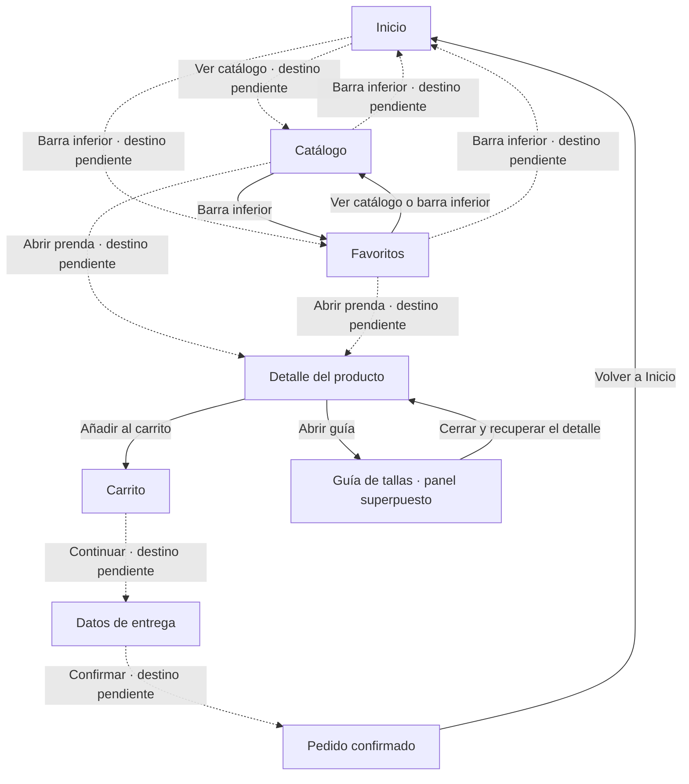

# Documentación de la interfaz · Pequeño Davante

## 1. Justificación del diseño

### 1.1 Importancia del diseño centrado en el usuario

Al pensar en la app de Pequeño Davante, he partido de una situación bastante normal. Una persona necesita comprar ropa infantil y mira el móvil en un rato libre. Puede estar haciendo otra cosa y tener solo una mano disponible. Por eso me interesa que encuentre las prendas sin tener que recorrer muchos menús.

La talla es una de las dudas que he tenido más en cuenta. Saber la edad del niño no siempre basta para elegir una prenda. En el detalle he dejado la guía de tallas junto a la selección de talla, para poder consultarla sin salir de la ficha. Las opciones sin stock tienen un estado distinto para que se vea que no están disponibles.

He colocado el botón de añadir al carrito en la parte baja del detalle. En el carrito se puede cambiar la cantidad y deshacer una eliminación. Así, si alguien toca donde no quería, tiene una forma de recuperar la prenda. El formulario de entrega muestra un error de email con un mensaje de ayuda. Son decisiones pensadas para que la persona sepa qué puede hacer y cómo corregirse.

### 1.2 Objetivos y metas del proyecto

He planteado estos objetivos para comprobar el diseño. Todavía son metas, no resultados de las pruebas.

1. Conseguir que cada participante complete el recorrido de compra de la chaqueta en verde oliva, talla 4 y cantidad 2, en menos de dos minutos y sin ayuda. Mediré el tiempo desde Inicio hasta Confirmación. Es una compra simulada dentro de Figma.

2. Conseguir que cada participante encuentre y abra la guía de tallas desde el detalle en menos de diez segundos y sin indicaciones. Anotaré si la encuentra al primer intento y si pulsa antes en otro sitio.

3. Conseguir que cada participante corrija el error de email y avance desde Entrega sin ayuda. Registraré cuánto tarda y los intentos fallidos, para comprobar si el mensaje explica bien el problema.

4. Comprobar que todas las parejas de color y su texto que documente en la guía de estilo tengan un contraste mínimo de 4,5 a 1 en los esquemas claro y oscuro. Guardaré los valores y sus ratios en la sección 3.3. Esta comprobación no sustituye las pruebas de lectura con personas.

Las pruebas se harán con al menos dos compañeros de otro grupo. Con una muestra tan pequeña, recogeré lo que le pase a cada persona sin presentar esos resultados como si representaran a todos los compradores.

### 1.3 Beneficios esperados

Para quien compra, espero que la guía de tallas ayude a decidir con más información. Tener el precio y la selección de talla en la misma ficha evita tener que recordar datos de otras pantallas. Poder revisar la cantidad y recuperar una prenda eliminada permite corregir la compra antes de confirmarla.

Para Pequeño Davante, una ficha clara podría reducir las consultas sobre tallas y evitar algunas compras equivocadas. Un formulario que explique los errores podría ayudar a que menos personas abandonen el proceso por no saber cómo seguir. Son beneficios esperados. El prototipo no permite demostrar una reducción de devoluciones ni un aumento de ventas.

## 2. Investigación y análisis de usuarios

### 2.1 Datos demográficos y segmentación

Pequeño Davante está pensada para personas adultas que compran ropa y calzado para niños de 0 a 14 años desde un móvil Android. Quien usa la app y decide la compra no tiene por qué ser quien va a llevar la prenda. Esto importa sobre todo al hacer un regalo, porque se puede conocer la edad del niño sin saber su talla.

He separado tres situaciones de compra. Las edades son orientativas y me sirven para construir los perfiles del proyecto. No proceden de una encuesta ni describen a todos los clientes de una tienda real.

| Grupo | Situación de compra | Qué necesita resolver | Qué debo tener en cuenta en el diseño |
| --- | --- | --- | --- |
| Padres y madres, aproximadamente de 30 a 45 años | Reponen ropa que se ha quedado pequeña o buscan prendas para otra temporada. Pueden consultar el catálogo en ratos cortos. | Localizar una prenda, comprobar la talla y revisar el importe antes de terminar. | Categorías visibles, precio junto a la prenda y un carrito donde se pueda cambiar la cantidad. |
| Familiares y amigos, aproximadamente de 20 a 30 años | Compran un regalo de forma puntual y pueden tener poca información sobre las medidas del niño. | Entender las tallas y completar la compra sin tener que crear una cuenta. | Guía de tallas accesible desde el detalle y acceso opcional a la cuenta. |
| Abuelos y otros familiares, aproximadamente de 60 a 75 años | Buscan una prenda para un nieto y pueden preferir revisar cada paso antes de confirmar. | Leer los datos con comodidad, reconocer las acciones y corregir una equivocación. | Texto con contraste, botones con etiqueta, áreas táctiles amplias y opción de deshacer al eliminar. |

No doy por hecho que una persona joven maneje bien cualquier app ni que alguien mayor necesite ayuda. Lo que cambia entre estos grupos es la situación que he elegido estudiar. Las dificultades de lectura, los toques imprecisos o las dudas con las tallas pueden aparecer a cualquier edad.

La falta de tiempo y el uso con una mano vienen del contexto del enunciado. El resto son supuestos de diseño que habrá que revisar con las pruebas. Las sesiones con compañeros servirán para detectar problemas del recorrido, pero no equivalen a investigar una muestra de padres, madres y abuelos.

### 2.2 Personas

He mantenido tres perfiles para pensar en necesidades distintas. Son personas ficticias creadas para el proyecto. Sus situaciones no son entrevistas ni resultados de las pruebas con compañeros.

#### Persona 1 · Laura, 36 años

Laura tiene dos hijos y suele encargarse de comprarles la ropa. Revisa la tienda por la noche, cuando encuentra un rato, y a veces deja una compra a medias para retomarla después. Usa el móvil a diario, pero no quiere dedicar mucho tiempo a entender una tienda nueva.

Su objetivo es encontrar una chaqueta, comprobar la talla disponible y revisar cuánto cuestan dos unidades. Le molesta entrar en una prenda para descubrir después que no queda la talla que necesita. Si interrumpe la compra, quiere poder localizar otra vez lo que le había gustado.

Para ella he tenido en cuenta el precio visible en el catálogo, los estados de talla y la pantalla de Favoritos. En el carrito puede ajustar la cantidad y revisar el importe. El prototipo permite ensayar ese recorrido con la chaqueta preparada para la compra. No demuestra que las prendas guardadas se conserven después de cerrar la app.

#### Persona 2 · David, 25 años

David quiere comprar un regalo para su sobrino. Sabe cuántos años tiene, pero no conoce sus medidas ni suele comprar ropa infantil. Maneja el móvil con soltura y espera poder mirar la tienda antes de decidir si quiere tener una cuenta.

Su objetivo es entender qué talla elegir y terminar el recorrido sin registrarse. Le frustra que una talla aparezca solo como un número sin ninguna referencia. Tampoco quiere perder la prenda que estaba viendo al consultar una ayuda.

La guía de tallas se abre sobre el detalle para que pueda consultarla y volver a la misma ficha. El inicio de sesión es opcional y tiene una salida para seguir sin cuenta. En Figma se simula esa elección, sin crear usuarios ni guardar datos personales. La guía es una referencia y no garantiza que una prenda le vaya a quedar bien al niño.

#### Persona 3 · Alberto, 68 años

Alberto busca una prenda para su nieta. Utiliza el móvil para mensajes y algunas compras, aunque prefiere avanzar despacio cuando una pantalla le resulta nueva. En este perfil he supuesto que necesita leer con la letra más grande y comprobar bien lo que ha seleccionado.

Su objetivo es distinguir el precio, elegir una talla y confirmar la compra sin miedo a haber añadido algo de más. Le molesta no saber qué significa un icono o que una pulsación borre un producto sin darle opción a recuperarlo.

Para este caso he priorizado las etiquetas de los botones, el contraste y las áreas táctiles. La acción Deshacer permite recuperar una prenda eliminada del carrito. En Entrega, el error de email explica qué debe corregir. El prototipo tiene un tamaño fijo de 360 × 800, por lo que no permite comprobar todavía cómo respondería una app real al aumentar el tamaño del texto en Android.

### 2.3 Análisis de la competencia

He comparado cuatro tiendas reales a partir de sus páginas públicas en español. Me he fijado en las tallas, la ayuda y la compra sin cuenta, porque son aspectos relacionados con los perfiles anteriores. Esta revisión es de sus webs y su información de ayuda. No he hecho una compra real ni una prueba completa de sus aplicaciones Android.

Las ventajas se apoyan en las páginas enlazadas. Los puntos mejorables recogen mi valoración del contenido consultado o un límite que encuentro al usarlo como referencia. No son resultados de pruebas con clientes de esas marcas.

| Tienda y fuente | Qué hace bien | Qué veo mejorable o qué límite encuentro | Registro y acceso comprobado | Qué me llevo para Pequeño Davante |
| --- | --- | --- | --- | --- |
| [Mayoral, ficha de una camiseta infantil](https://www.mayoral.com/es/es/camiseta-volante-nina-anis-2603008074-5) | Reúne fotos, precio, opciones de color, selección de talla y acceso a la guía en la ficha. | La descripción combina información de la prenda con una explicación sobre el algodón. Para una consulta rápida, prefiero separar la selección de compra de ese contenido adicional. | La ficha se puede consultar públicamente. Esta revisión no confirma si el pago exige una cuenta. | Mantener foto, precio, talla y guía en el mismo detalle, con la acción de compra fácil de localizar. |
| [Vertbaudet, guía de calzado](https://www.vertbaudet.es/page/asesoramiento/guias/calzado.htm) | Explica cómo medir el pie e incluye una calculadora que parte de su longitud en milímetros. Da una referencia más concreta que la edad. | La guía reúne muchos consejos por etapas. Para consultar una medida mientras elijo una prenda, prefiero una ayuda más breve y centrada en esa duda. | La guía es pública. La página ofrece acceso a una cuenta, pero eso no demuestra que el registro sea obligatorio para comprar. | Usar medidas y una explicación visual en la guía. Abrirla como panel sobre el detalle para poder volver a la prenda al cerrarla. |
| [Kiabi, ayuda para hacer un pedido](https://www.kiabi.es/servicios/pedido.html) | Explica la compra como invitado, la confirmación por email y el seguimiento sin cuenta. | El invitado no tiene el seguimiento desde una cuenta ni las ventajas de fidelidad. Me parece un límite que conviene explicar al elegir cómo comprar. | Confirma que se puede continuar sin cuenta. Por tanto, no corresponde describir su registro como obligatorio. | Dejar el inicio de sesión como opción. Para una futura app, explicar qué se guarda con una cuenta antes de pedir que se cree. |
| [Zara, centro de ayuda en España](https://www.zara.com/es/es/help/compra-segura-h28.html) | Separa los temas de tallas, favoritos, pedidos y devoluciones en grupos reconocibles. | La ayuda cubre muchos servicios de la marca. Para resolver una duda concreta sobre una talla, prefiero ofrecer un acceso desde la propia prenda sin obligar a buscar entre todos los temas. | El índice de ayuda es público y contiene un apartado de registro. El índice por sí solo no permite confirmar las condiciones de compra sin cuenta. | Mantener la guía junto al selector de talla y los destinos principales visibles en la navegación inferior. |

La comparación me sirve para elegir soluciones concretas, sin intentar trasladar una tienda entera al prototipo. En Pequeño Davante he dado más espacio a la elección de talla y a la revisión del carrito. La ayuda sobre medidas aparece cuando hace falta, dentro del recorrido de la prenda.

Fuentes consultadas el 15 de octubre de 2026. Los enlaces quedan guardados en FUENTES.md para preparar las referencias del apartado 6.

### 2.4 Insights y hallazgos clave

A partir del enunciado, los perfiles ficticios y las referencias de otras tiendas, he sacado estas ideas para orientar el diseño. Todavía no son hallazgos de pruebas con usuarios. Cada una queda ligada a una decisión que se puede revisar en el prototipo.

| Idea que orienta el diseño | De dónde sale | Decisión en Pequeño Davante | Cómo comprobarla |
| --- | --- | --- | --- |
| Conocer la edad del niño no resuelve por sí solo la elección de talla. | La duda con las tallas aparece en el enunciado y en el perfil de David. Vertbaudet muestra una ayuda basada en medidas. | Poner la guía junto al selector de talla y abrirla como panel sobre el detalle. | Pedir que consulten la guía y registrar si la encuentran sin ayuda y cuánto tardan. |
| Una compra puede interrumpirse antes de tomar una decisión. | Es una situación prevista en el perfil de Laura, no una frecuencia medida. | Incluir Favoritos como destino de la navegación inferior para poder volver a las prendas mostradas allí. | Comprobar si localizan Favoritos y vuelven al detalle. La persistencia después de cerrar la app queda fuera del prototipo. |
| Eliminar una prenda por error no debería obligar a buscarla otra vez. | El perfil de Alberto plantea dudas al tocar acciones que cambian la compra. | Mostrar Deshacer en el aviso de eliminación del carrito. | Observar si la persona reconoce la acción y recupera el producto. Puede comprobarse como tarea adicional a las tres principales. |
| Pedir una cuenta puede añadir un paso que no necesita quien compra de forma puntual. | Necesidad planteada para David y existencia de compra como invitado en Kiabi. | Mantener el inicio de sesión opcional, con una salida para continuar sin cuenta. | Revisar que la compra pueda recorrerse sin pasar por el inicio de sesión. No se simula un alta de usuario. |
| Un error de formulario necesita explicar qué corregir. | Objetivo de evitar bloqueos en Entrega y necesidad de Alberto de entender cómo seguir. | Mostrar el email en estado de error con un mensaje de ayuda en el propio campo. | Pedir que corrijan el error y medir tiempo, intentos y necesidad de ayuda. |
| Antes de confirmar conviene poder relacionar la cantidad con el importe. | Laura quiere comprar dos unidades y revisar el coste. | Mantener los controles de cantidad y el resumen juntos en el carrito. El recorrido preparado muestra dos chaquetas y un total de 78 €. | Comprobar si identifican la cantidad y el total durante la tarea de compra. |

Estas decisiones cubren problemas distintos. Si las pruebas muestran que la guía no se encuentra o que Deshacer pasa desapercibido, la mejora tendrá que responder a ese problema concreto. No daré una decisión por validada solo porque esté dibujada en Figma.

## 3. Diseño de la interfaz
### 3.1 Mapa de navegación

He organizado la compra alrededor de siete pantallas. Inicio presenta la tienda, Catálogo permite ver las prendas y Detalle reúne la información para elegir. Después están Carrito, Datos de entrega y Pedido confirmado. Favoritos permite volver a las prendas mostradas como guardadas.

El mapa recoge la estructura prevista y el estado de las conexiones en el archivo definitivo. Las flechas continuas son enlaces con un destino identificado en Figma. Las discontinuas indican pasos necesarios para el recorrido que aparecen sin destino en la consulta del archivo del 15 de octubre de 2026. No doy esos pasos por comprobados.

La guía de tallas es un bottom sheet. Se abre sobre el detalle y tiene acciones de cierre. No la cuento como una octava pantalla principal. Inicio y Detalle tienen además una versión oscura, que cambia la presentación visual sin añadir una etapa de compra.

La barra inferior tiene tres destinos, Inicio, Catálogo y Favoritos. En el detalle y durante la compra se usa el retorno de la cabecera. El archivo contiene acciones de volver atrás, que dependen de la pantalla desde la que se haya llegado.

El archivo definitivo consultado tiene las páginas Wireframes y Prototipo. No contiene la pantalla de inicio de sesión que figuraba en las notas de una versión anterior. Por eso no la incluyo en este mapa.

Para dar por terminado el requisito de navegación habría que asignar los destinos que faltan, definir el punto inicial del flujo y recorrer la compra en Present. En esta revisión no se ha modificado Figma.

### 3.2 Wireframes
### 3.3 Guía de estilo Material Design 3
### 3.4 Prototipo de alta fidelidad

## 4. Validación y pruebas
### 4.1 Metodología                          
### 4.2 Resultados                           
### 4.3 Iteraciones y mejoras               
## 5. Entrega y documentación final
### 5.1 Justificación del diseño propuesto
### 5.2 Recomendaciones y pasos a seguir

## 6. Referencias bibliográficas              
Palabra del día: 29