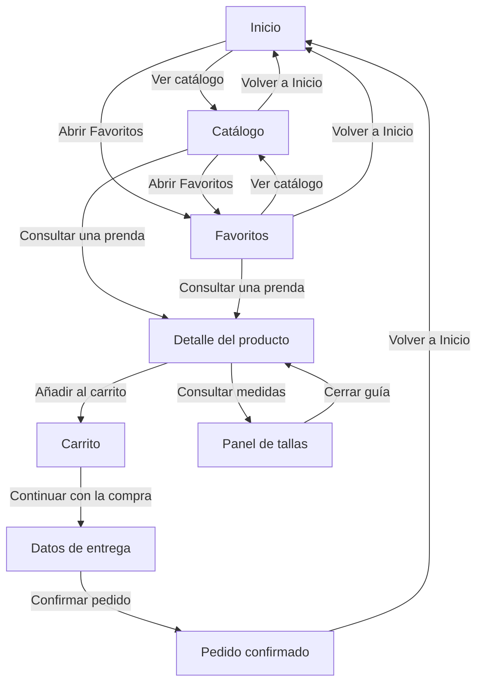

# Documentación de la interfaz - Pequeño Davante

## 1. Justificación del diseño

### 1.1 Importancia del diseño centrado en el usuario

Al plantear la app de Pequeño Davante, me he centrado en cómo la usaría alguien que entra a comprar ropa infantil desde el móvil, muchas veces será una madre, un padre o un familiar que tiene poco tiempo y mira la tienda mientras hace otra cosa, por eso he intentado que las opciones principales se vean sin tener que ir abriendo menús

Una de las cosas que más dudas puede dar es la talla, saber los años que tiene un niño no siempre sirve para acertar con la ropa, he dejado la guía en la propia ficha, al lado del selector de talla, para poder consultarla sin salir de la prenda, las tallas sin stock tienen un estado distinto para no confundirlas con las disponibles

El botón de añadir al carrito está en la parte baja de la pantalla para tenerlo más a mano, en el carrito aparecen la cantidad y el importe, y en el formulario de entrega hay un ejemplo de email incorrecto con un mensaje de ayuda, me interesa que se entienda qué hay que hacer en cada paso y cómo corregir un error

### 1.2 Objetivos y metas del proyecto

Para comprobar si el diseño se entiende, he marcado cuatro objetivos, los tres primeros se medirán en las pruebas con al menos dos compañeros de otro grupo, el último se comprobará con los colores de la guía de estilo

- Completar la compra de la chaqueta en verde oliva, talla 4 y cantidad 2 en menos de dos minutos y sin ayuda, contaré desde Inicio hasta Confirmación, la tarea consiste en encontrar la chaqueta, elegir la talla y revisar la cantidad antes de confirmar
- Encontrar y abrir la guía de tallas desde el detalle en menos de diez segundos, sin indicar dónde está, apuntaré si la encuentran a la primera o si antes pulsan en otro sitio
- Corregir el error de email y continuar desde Entrega sin ayuda, mediré el tiempo y los intentos fallidos para ver si el mensaje explica bien qué hay que cambiar
- Revisar que todas las parejas de color y texto de la guía tengan un contraste mínimo de 4,5 a 1, tanto en claro como en oscuro, los valores quedarán en el apartado 3.3

Son objetivos para las pruebas, no resultados que ya haya conseguido, como participarán pocos compañeros, recogeré lo que le ocurra a cada uno sin sacar porcentajes sobre todos los posibles clientes

### 1.3 Beneficios esperados

Para quien compra, la idea es poder consultar la talla, ver el precio y revisar la cantidad sin ir saltando entre pantallas, si el formulario explica qué dato está mal, debería ser más fácil corregirlo y seguir con la compra

Para la tienda, una guía de tallas clara podría evitar algunas dudas y compras equivocadas, un proceso fácil de seguir podría ayudar a que menos personas dejen el carrito a medias, de momento son beneficios que espero del diseño, para saber si bajan las devoluciones o suben las ventas haría falta probar la app con clientes reales

## 2. Investigación y análisis de usuarios

### 2.1 Datos demográficos y segmentación

Pequeño Davante está pensada para personas adultas que compran ropa y calzado para niños de 0 a 14 años desde un móvil Android, quien usa la app y decide la compra no tiene por qué ser quien va a llevar la prenda, esto importa sobre todo al hacer un regalo, porque se puede conocer la edad del niño sin saber su talla

He dividido el público en tres grupos según la situación de compra, las edades son orientativas y me sirven para plantear los perfiles, no salen de una encuesta

| Grupo | Situación de compra | Qué necesita resolver | Qué debo tener en cuenta en el diseño |
| --- | --- | --- | --- |
| Padres y madres, aproximadamente de 30 a 45 años | Reponen ropa que se ha quedado pequeña o buscan prendas para otra temporada, pueden consultar el catálogo en ratos cortos | Localizar una prenda, comprobar la talla y revisar el importe antes de terminar | Categorías visibles, precio junto a la prenda y controles de cantidad en el carrito |
| Familiares y amigos, aproximadamente de 20 a 30 años | Compran un regalo de forma puntual y pueden tener poca información sobre las medidas del niño | Entender las tallas y completar la compra sin tener que crear una cuenta | Guía de tallas accesible desde el detalle y recorrido de compra sin un paso de registro |
| Abuelos y otros familiares, aproximadamente de 60 a 75 años | Buscan una prenda para un nieto y pueden preferir revisar cada paso antes de confirmar | Leer los datos con comodidad, reconocer las acciones y corregir una equivocación | Texto con contraste, botones con etiqueta, áreas táctiles amplias y opción de deshacer al eliminar |

La edad no dice por sí sola cómo usa alguien el móvil, una persona joven puede perderse con las tallas y una persona mayor puede comprar online sin problemas, me he fijado en lo que necesita resolver cada perfil

He tenido en cuenta las compras en ratos cortos y el uso del móvil con una mano, porque en esas situaciones cuesta más acertar con botones pequeños o recordar datos de otras pantallas

### 2.2 Personas

He creado tres perfiles para tener en cuenta distintas formas de comprar, son perfiles ficticios que me sirven para relacionar cada necesidad con una decisión de diseño

#### Persona 1 - Laura, 36 años

- Laura tiene dos hijos y suele encargarse de comprarles la ropa, mira la tienda por la noche, cuando tiene un rato, y a veces deja una compra a medias
- Quiere encontrar una chaqueta, comprobar si queda su talla y ver cuánto cuestan dos unidades
- Le molesta entrar en una prenda y descubrir después que no hay stock, si deja la compra para otro día, quiere poder volver a lo que le había gustado
- Para ella he tenido en cuenta el precio visible en el catálogo, los estados de talla y Favoritos, el carrito reúne los controles de cantidad y el importe, el guardado de favoritos entre sesiones quedaría para una app real

#### Persona 2 - David, 25 años

- David busca un regalo para su sobrino, sabe los años que tiene, pero no conoce sus medidas ni suele comprar ropa infantil
- Quiere entender qué talla elegir y comprar sin tener que crear una cuenta
- Le cuesta decidir si la talla aparece solo como un número, tampoco quiere perder la ficha de la prenda al abrir la ayuda
- Por eso la guía se abre sobre el detalle y permite volver a la misma prenda al cerrarla, el recorrido está planteado sin un paso de registro, el archivo definitivo no tiene login ni un sistema de cuentas

#### Persona 3 - Alberto, 68 años

- Alberto quiere comprarle una prenda a su nieta, usa el móvil para mensajes y algunas compras, pero prefiere ir despacio cuando no conoce una pantalla, para este perfil he supuesto que necesita la letra más grande
- Quiere leer bien el precio, elegir la talla y comprobar que no ha añadido algo de más
- Le frustra no entender un icono o borrar un producto sin saber cómo recuperarlo
- Para él he tenido en cuenta las etiquetas de los botones, el contraste y las áreas táctiles, la opción Deshacer responde a su miedo a borrar algo por error, mientras que el mensaje del email le indica qué dato tiene que corregir

### 2.3 Análisis de la competencia

He revisado las webs y la ayuda en español de cuatro tiendas, me he fijado sobre todo en las tallas y en los pasos para comprar, porque son las dudas que aparecen en los perfiles, la tabla separa lo que he podido comprobar de lo que yo cambiaría para Pequeño Davante, no he hecho compras ni probado sus apps Android

| Tienda | Qué hace bien | Qué veo mejorable o qué límite encuentro | Registro y acceso comprobado | Qué me llevo para Pequeño Davante |
| --- | --- | --- | --- | --- |
| Mayoral | Reúne fotos, precio, opciones de color, selección de talla y acceso a la guía en la ficha | La descripción combina información de la prenda con una explicación sobre el algodón, para una consulta rápida, prefiero separar la selección de compra de ese contenido adicional | La ficha se puede consultar públicamente, esta revisión no confirma si el pago exige una cuenta | Mantener foto, precio, talla y guía en el mismo detalle, con la acción de compra fácil de localizar |
| Vertbaudet | Explica cómo medir el pie e incluye una calculadora que parte de su longitud en milímetros, da una referencia más concreta que la edad | La guía reúne muchos consejos por etapas, para consultar una medida mientras elijo una prenda, prefiero una ayuda más breve y centrada en esa duda | La guía es pública, la página ofrece acceso a una cuenta, pero eso no demuestra que el registro sea obligatorio para comprar | Usar medidas y una explicación visual en la guía, abrirla como panel sobre el detalle para poder volver a la prenda al cerrarla |
| Kiabi | Explica la compra como invitado, la confirmación por email y el seguimiento sin cuenta | El invitado no tiene el seguimiento desde una cuenta ni las ventajas de fidelidad, me parece un límite que conviene explicar al elegir cómo comprar | Confirma que se puede continuar sin cuenta, por tanto, no corresponde describir su registro como obligatorio | Dejar el inicio de sesión como opción, para una futura app, explicar qué se guarda con una cuenta antes de pedir que se cree |
| Zara | Separa los temas de tallas, favoritos, pedidos y devoluciones en grupos reconocibles | La ayuda cubre muchos servicios de la marca, para resolver una duda concreta sobre una talla, prefiero ofrecer un acceso desde la propia prenda sin obligar a buscar entre todos los temas | El índice de ayuda es público y contiene un apartado de registro, el índice por sí solo no permite confirmar las condiciones de compra sin cuenta | Mantener la guía junto al selector de talla y los destinos principales visibles en la navegación inferior |

De estas tiendas me quedo con la ayuda cerca de la talla y con no pedir una cuenta antes de mirar las prendas, en Pequeño Davante he intentado que la ficha y el carrito tengan la información necesaria para decidir sin llenarlos de opciones

### 2.4 Insights y hallazgos clave

De los perfiles y la comparativa he sacado estas seis ideas, cada una relacionada con una decisión de diseño y una forma de comprobar si se entiende

| Idea que orienta el diseño | De dónde sale | Decisión en Pequeño Davante | Cómo comprobarla |
| --- | --- | --- | --- |
| Conocer la edad del niño no resuelve por sí solo la elección de talla | David conoce la edad de su sobrino, pero no sus medidas | Poner la guía junto al selector de talla y abrirla como panel sobre el detalle | Pedir que consulten la guía y registrar si la encuentran sin ayuda y cuánto tardan |
| Una compra puede interrumpirse antes de tomar una decisión | Es una situación prevista en el perfil de Laura, no una frecuencia medida | Incluir Favoritos como destino de la navegación inferior para poder volver a las prendas mostradas allí | Comprobar si localizan Favoritos y vuelven al detalle, la persistencia después de cerrar la app queda fuera del prototipo |
| Eliminar una prenda por error no debería obligar a buscarla otra vez | El perfil de Alberto plantea dudas al tocar acciones que cambian la compra | Incluir la recuperación del producto eliminado entre las acciones que necesita el carrito | Pedir que recuperen una prenda eliminada y observar si identifican la acción sin ayuda |
| Pedir una cuenta puede añadir un paso que no necesita quien compra de forma puntual | Necesidad planteada para David y existencia de compra como invitado en Kiabi | Plantear el recorrido sin un paso de registro, el archivo definitivo no tiene pantalla de inicio de sesión | Comprobar si la persona entiende los pasos de compra sin buscar antes un botón de registro |
| Un error de formulario necesita explicar qué corregir | Objetivo de evitar bloqueos en Entrega y necesidad de Alberto de entender cómo seguir | Mostrar el email en estado de error con un mensaje de ayuda en el propio campo | Pedir que corrijan el error y medir tiempo, intentos y necesidad de ayuda |
| Antes de confirmar conviene poder relacionar la cantidad con el importe | Laura quiere comprar dos unidades y revisar el coste | Mantener los controles de cantidad y el resumen juntos en el carrito, dos chaquetas de 39 € deben sumar 78 €, que es el importe esperado para esa tarea | Comprobar si identifican la cantidad y el total durante la tarea de compra |

Si en las pruebas alguien no encuentra la guía o no entiende una acción, usaré ese problema para decidir qué mejorar

## 3. Diseño de la interfaz
### 3.1 Mapa de navegación

He organizado la tienda para que se pueda empezar a mirar ropa desde Inicio, sin pasar antes por un registro, las tres opciones de la barra inferior son Inicio, Catálogo y Favoritos, cada una tiene una función distinta para no llenar una sola pantalla con todo

- Inicio presenta las categorías y la prenda de temporada, sirve como entrada a la tienda y permite decidir por dónde empezar
- Catálogo reúne las prendas con su nombre y precio, junto a los filtros de edad o talla, color y precio y la opción de ordenar
- Favoritos reúne las prendas guardadas para volver a ellas sin buscarlas otra vez en el catálogo

El siguiente mapa representa la estructura de navegación planteada para el diseño, las flechas explican las acciones que llevan de una pantalla a otra, no son un registro de pruebas de funcionamiento

#### Recorrido de compra

La compra empieza al encontrar una prenda que interesa, desde el catálogo se consulta el detalle para ver la foto, el precio y las tallas, he separado estas dos pantallas porque en el catálogo interesa comparar varias prendas y en el detalle hace falta centrarse en una sola

La elección de talla pertenece al detalle, no tiene una pantalla aparte, así se puede consultar la guía y volver a la selección sin perder de vista qué producto se está comprando, la talla agotada debe distinguirse de las disponibles antes de añadir la prenda

El carrito queda entre la selección y los datos de entrega para poder revisar la compra antes de rellenar el formulario, ahí se reúnen la prenda, la talla, la cantidad y el importe, este paso permite detectar una cantidad equivocada antes de confirmar

Después aparecen los datos de contacto y dirección, el mensaje de error del email ayuda a entender qué hay que corregir, la confirmación cierra el recorrido con un número de pedido y el resumen de la compra, y ofrece volver a Inicio

#### Consulta de tallas

La guía es un panel que se abre sobre la ficha de la prenda, lo he planteado así porque consultar una medida es una ayuda dentro de la elección, al cerrarlo se recupera el detalle sin tener que recorrer de nuevo el catálogo

El panel no cuenta como otra etapa de compra, su función es resolver la duda antes de añadir la prenda, por eso aparece conectado al detalle y vuelve al mismo sitio

#### Vuelta a las pantallas principales

La barra inferior permite reconocer dónde se está entre Inicio, Catálogo y Favoritos, en la ficha y en los pasos de compra la flecha de la cabecera sirve para volver a la pantalla anterior

Las versiones oscuras de Inicio y Detalle mantienen la misma información y distribución, no añaden destinos al mapa porque representan esas mismas pantallas con otros colores

### 3.2 Wireframes

Los siete wireframes tienen un tamaño de 360 × 800 y muestran cómo se reparte el contenido de cada pantalla, he usado esta versión para centrarme en el orden de la información, el espacio de las imágenes y la posición de los botones

Las fotos están representadas con bloques y los botones llevan su texto para entender qué hace cada uno, predominan los grises, aunque en la confirmación queda un texto con un ligero tono azul

#### Inicio

He colocado el buscador arriba y las categorías justo debajo, después aparece la prenda de temporada con el botón Ver catálogo, así se puede empezar por una categoría o ir directamente a ver la ropa

Las categorías se ven antes de entrar al catálogo para orientar a quien ya sabe qué tipo de ropa busca, el buscador ofrece otra entrada para quien llega con una idea más concreta, son dos formas de empezar que responden a situaciones distintas

La prenda destacada tiene un espacio más grande porque presenta la temporada, pero no ocupa toda la pantalla, he dejado la navegación inferior separada para que se reconozca aunque cambie el contenido de la tienda

#### Catálogo

Los filtros están encima de los productos, he usado dos columnas y he dejado el nombre y el precio debajo de cada foto para comparar las prendas sin entrar en todas las fichas

He separado los filtros de las tarjetas para que no compitan con el nombre y el precio de cada prenda, la opción de ordenar aparece en su propia línea porque cambia cómo se presentan los resultados, mientras que los filtros sirven para acotar lo que se busca

Cada tarjeta mantiene el mismo orden de información para comparar de arriba abajo sin tener que localizar el precio en un sitio diferente cada vez, el texto de agotado avisa de la disponibilidad sin depender solo del aspecto de la imagen

#### Detalle del producto

La foto va arriba, seguida del nombre y el precio, debajo están las tallas y la guía para consultarla antes de añadir la prenda, la talla agotada lleva el texto sin stock y el botón de compra queda en la parte baja

En esta pantalla he dado prioridad a lo que hace falta para decidir la compra, la foto permite reconocer el producto, el precio indica el coste y las tallas muestran las opciones de elección, la ayuda queda justo en el punto donde puede aparecer la duda

He dejado un espacio separado para la información de la prenda, así se puede explicar el producto sin mezclar esa descripción con los controles, el botón de compra mantiene su sitio en la parte baja para encontrarlo después de revisar la talla

#### Carrito

Junto a la prenda están la cantidad y la opción de eliminarla, debajo aparecen el subtotal y el total antes de continuar, esta captura muestra una chaqueta de talla 4, una unidad y un total de 39 €

La imagen y el nombre ayudan a reconocer que se ha añadido la prenda correcta, la talla aparece en el mismo bloque para revisar la selección sin volver al detalle, los controles de cantidad quedan cerca porque afectan a ese producto concreto

La eliminación tiene una etiqueta visible para distinguirla del cambio de cantidad, el resumen de importes está separado de la ficha del producto y colocado antes de continuar, así se puede revisar qué se compra y cuánto cuesta en el mismo paso

#### Datos de entrega

He puesto los campos en una columna, primero los datos de contacto y después la dirección, el email tiene un ejemplo de ayuda, en el prototipo final se verá el campo con el estado de error

He separado nombre y email de los datos de dirección para seguir un orden fácil de entender, cada campo ocupa su propia fila para que no haya que repartir la atención entre dos entradas pequeñas, el mensaje del email indica el formato que se espera

El importe aparece antes del botón de confirmación para mantener la referencia del coste mientras se rellenan los datos, esta pantalla está centrada en contacto y entrega, no incluye una entrada de tarjeta ni una pasarela de pago real

#### Pedido confirmado

La pantalla muestra Pedido realizado, el número 12-PD y el resumen de la chaqueta, he dejado el botón Volver a Inicio abajo para seguir mirando la tienda, el pedido es de demostración

Después del formulario hace falta una respuesta clara que permita reconocer que el recorrido ha terminado, por eso el mensaje de confirmación aparece junto al identificador y no queda solo una imagen sin explicación

El resumen incluye la prenda, la talla, las unidades y el total para poder contrastarlo con el carrito, la vuelta a Inicio es la acción principal de salida, no he añadido opciones de seguimiento que no forman parte de este diseño

#### Favoritos

He mantenido las dos columnas del catálogo para que las tarjetas se vean igual, una prenda aparece como agotada y la barra inferior marca Favoritos como pantalla activa

Repetir la estructura de las tarjetas evita tener que aprender otra forma de consultar las prendas, aquí la diferencia es el motivo por el que aparecen, se reúnen como una selección que interesa revisar, en lugar de representar todo el catálogo

Mostrar el precio y el estado de disponibilidad permite valorar esa selección antes de abrir el detalle, la pantalla sirve como referencia para volver a una prenda, mientras que el carrito se reserva para revisar lo que se quiere comprar

### 3.3 Guía de estilo Material Design 3

He reunido aquí las decisiones que se repiten en las pantallas para que la tienda tenga el mismo aspecto al pasar de una a otra, me he centrado en los colores, la letra, los espacios y los elementos que se usan para comprar

He seguido Material Design 3 como base para los botones, los campos y la navegación, pero he intentado explicar cada elección según lo que necesita Pequeño Davante, lo importante para mí es que se reconozca dónde mirar una prenda, cómo elegir una talla y cuál es el siguiente paso

#### Colores de las pantallas

He tomado el azul #0234AB como referencia principal, lo he reservado para dar presencia a las acciones y a los elementos que quiero que se reconozcan dentro de la tienda, el fondo claro es más suave para que no tenga el mismo peso que los botones

El color secundario sigue dentro de los azules, así puedo diferenciar elementos sin introducir un color distinto para cada cosa, el tono coral queda como apoyo, no lo uso como si fuera el texto principal de toda la interfaz

En el modo oscuro el fondo pasa a azul muy oscuro y el principal se aclara, he mantenido la distribución para que se pueda reconocer la pantalla sin aprender de nuevo dónde está cada elemento

| Uso | Claro | Oscuro |
| --- | --- | --- |
| Color principal | #0234AB | #AFC6FF |
| Texto sobre el principal | #FFFFFF | #06205F |
| Fondo de selección suave | #EAF1FC | #173A85 |
| Texto sobre esa selección | #082B65 | #EAF1FC |
| Color secundario | #2D5FAA | #ADC7F5 |
| Color de apoyo | #FF5B41 | #FFB49F |
| Fondo de pantalla | #F5F8FD | #101B30 |
| Texto principal | #17243D | #F0F4FC |

He separado el color de un fondo del texto que va encima, por ejemplo, el botón principal claro usa azul y texto blanco, mientras que su versión oscura combina un azul claro con un texto más oscuro, así el cambio de modo no consiste solo en oscurecer todo

Los nombres que empiezan por on indican el color del contenido que se coloca sobre otro, onPrimary corresponde al texto o icono situado sobre primary, mantengo estos nombres en las tablas porque permiten relacionar los valores con los de Figma

#### Contraste de las pantallas

He calculado el contraste de las parejas que aparecen vinculadas en las paletas de las pantallas, en estas combinaciones el mínimo que busco es 4,5 a 1, el cálculo se hace con los colores completos, sin transparencias

| Pantallas | Fondo y texto | Contraste |
| --- | --- | --- |
| Claras | #0234AB / #FFFFFF | 10,09 a 1 |
| Claras | #EAF1FC / #082B65 | 11,97 a 1 |
| Claras | #F5F8FD / #17243D | 14,55 a 1 |
| Oscuras | #AFC6FF / #06205F | 8,95 a 1 |
| Oscuras | #173A85 / #EAF1FC | 9,33 a 1 |
| Oscuras | #101B30 / #F0F4FC | 15,60 a 1 |

Estas cifras corresponden a las combinaciones de la tabla, no significan que cualquier color se pueda usar sobre cualquier fondo, por eso prefiero mantener las parejas y no cambiar el texto de un botón solo porque otro tono quede bien al lado

Para los errores he usado un rojo distinto del azul de las acciones, el campo de email se acompaña de una explicación para que el aviso no dependa únicamente del color, de la misma forma, la talla agotada lleva texto que permite reconocer su estado

#### Tema incluido en el archivo de Figma

El archivo contiene además un tema llamado material-theme con esquemas claro y oscuro, sus colores no coinciden con la paleta azul vinculada a las pantallas, por eso los recojo en una tabla aparte y no los presento como si fueran los mismos valores

He incluido las doce parejas del tema, seis para cada modo, para relacionar cada color con el texto que le corresponde y comprobar sus contrastes

| Esquema | Pareja | Color | Texto | Contraste |
| --- | --- | --- | --- | --- |
| Claro | primary / onPrimary | #65558F | #FFFFFF | 6,46 a 1 |
| Claro | primaryContainer / onPrimaryContainer | #EADDFF | #4F378B | 7,23 a 1 |
| Claro | secondary / onSecondary | #625B71 | #FFFFFF | 6,45 a 1 |
| Claro | tertiary / onTertiary | #7D5260 | #FFFFFF | 6,47 a 1 |
| Claro | surface / onSurface | #FEF7FF | #1D1B20 | 16,23 a 1 |
| Claro | error / onError | #B3261E | #FFFFFF | 6,54 a 1 |
| Oscuro | primary / onPrimary | #D0BCFE | #381E72 | 7,71 a 1 |
| Oscuro | primaryContainer / onPrimaryContainer | #4F378B | #EADDFF | 7,23 a 1 |
| Oscuro | secondary / onSecondary | #CCC2DC | #332D41 | 7,74 a 1 |
| Oscuro | tertiary / onTertiary | #EFB8C8 | #492532 | 7,75 a 1 |
| Oscuro | surface / onSurface | #141218 | #E6E0E9 | 14,35 a 1 |
| Oscuro | error / onError | #F2B8B5 | #601410 | 7,66 a 1 |

Todas estas parejas del tema superan 4,5 a 1, esta comprobación describe esos valores concretos y no acredita por sí sola que el tema esté aplicado a todas las pantallas, la paleta visible del diseño está recogida en las tablas anteriores

#### Tipografía

He usado Roboto para mantener una misma letra en toda la tienda, he cambiado el tamaño y el grosor según la función del texto, así un título, una descripción y la etiqueta de un botón no tienen que verse iguales

No he intentado destacar todo a la vez, si el nombre, el precio y la descripción tuvieran el mismo tamaño sería más difícil reconocer qué información mirar primero, por eso he mantenido una diferencia entre los títulos y el texto de apoyo

| Nombre en Figma | Tamaño | Espacio entre líneas | Grosor | Para qué lo uso |
| --- | --- | --- | --- | --- |
| headlineSmall | 24 | 32 | Normal, 400 | Titulares como el de la temporada en Inicio |
| titleLarge | 22 | 28 | Normal, 400 | Nombre principal de la prenda en el detalle |
| titleMedium | 16 | 24 | Medio, 500 | Información destacada como el precio |
| bodyLarge | 16 | 24 | Normal, 400 | Mensajes y textos de contenido |
| labelLarge | 14 | 20 | Medio, 500 | Etiquetas de botones y controles |

El espacio entre líneas evita que el texto quede demasiado pegado cuando ocupa más de una línea, he mantenido las etiquetas de las acciones cortas para que se puedan leer sin tener que interpretar una frase larga antes de pulsar

Hay otros tamaños para datos pequeños, como la hora de la barra superior, los cinco anteriores son los que utilizo como referencia para organizar la información principal

#### Rejilla y espacios

He usado una rejilla de cuatro columnas con 16 de margen a cada lado y 8 de separación entre columnas, me sirve para alinear el contenido aunque cada pantalla tenga una distribución distinta

En una pantalla de 360 de ancho, los márgenes dejan 328 para el contenido, dentro de ese espacio coloco elementos que ocupan todo el ancho, como los campos y los botones principales, o bloques más pequeños, como las tarjetas del catálogo

| Medida | Valor | Cómo la utilizo |
| --- | --- | --- |
| Tamaño de pantalla | 360 × 800 | Base común para los frames |
| Columnas | 4 | Referencia para alinear bloques |
| Margen lateral | 16 | Separación respecto al borde |
| Separación entre columnas | 8 | Espacio de la rejilla |
| Base de espaciado | 8 | Referencia para separar los elementos |
| Área mínima de pulsación que tomo como referencia | 48 × 48 | Espacio para tocar una acción |

La rejilla de cuatro columnas no obliga a mostrar cuatro productos por fila, en el catálogo he usado dos tarjetas, lo que me permite dar más espacio a la imagen, al nombre y al precio, la rejilla sirve para ordenar la pantalla, no para llenar todas sus columnas con elementos distintos

He tomado 8 como base para los espacios, así puedo usar separaciones de 8, 16 o 24 según si dos elementos pertenecen al mismo grupo o si empieza otro bloque, la separación entre una foto y su nombre puede ser más corta que la que dejo entre grupos de información

#### Tamaño de los botones y las zonas que se pueden tocar

He tomado 48 × 48 como referencia mínima para las zonas de pulsación, el dibujo de un icono puede ser más pequeño que ese espacio, lo que importa es que haya sitio alrededor para tocarlo sin acertar justo en el centro

Esta diferencia es útil en las flechas, los corazones y los controles de cantidad, no hace falta hacer enorme el símbolo para que la acción tenga una zona cómoda, hay que cuidar el espacio que responde a la pulsación y la separación respecto a otras acciones

En los botones principales he dado prioridad al ancho disponible y a una etiqueta que explique el siguiente paso, en los controles pequeños he intentado que se distinga qué elemento se está tocando, sobre todo cuando hay opciones próximas como varias tallas

#### Elementos que se repiten

He mantenido una misma forma de presentar las acciones para que el cambio de pantalla no obligue a aprender otra manera de comprar

- La cabecera identifica la pantalla y sitúa la vuelta atrás cuando hace falta
- La barra inferior mantiene los tres destinos principales, Inicio, Catálogo y Favoritos
- Las tarjetas reúnen foto, nombre y precio para comparar las prendas
- Los filtros permiten presentar las opciones de edad o talla, color y precio en el catálogo
- Los botones principales indican acciones como añadir al carrito, continuar o volver a Inicio
- Los campos de entrega mantienen el mismo orden de etiqueta y contenido, el email muestra un ejemplo de error con ayuda
- El panel de tallas reúne la información de medidas sin sustituir la ficha de la prenda
- El aviso de eliminación con Deshacer responde a la necesidad de recuperar una prenda borrada por error, su presencia en una propuesta no sustituye comprobar su funcionamiento

#### Componentes propios

He planteado la tarjeta de producto y el selector de talla como elementos que deben mantener la misma estructura aunque cambie su estado, así no tengo que reorganizar toda la ficha para mostrar una prenda guardada o una talla agotada

| Componente | Estados que necesito distinguir | Por qué los separo |
| --- | --- | --- |
| Tarjeta de producto | Normal, favorito y agotado | Una misma prenda puede interesar, estar guardada o no estar disponible |
| Selector de talla | Disponible, seleccionada y sin stock | Hay que diferenciar lo que se puede elegir de lo que ya está elegido |
| Selector de color | Normal, seleccionado y sin disponibilidad | El color elegido tiene que reconocerse dentro del grupo de opciones |

Al reutilizar estos elementos, me interesa que la imagen, el texto y las opciones mantengan su orden, la organización automática de los espacios dentro del componente ayuda a conservar esa relación, no significa que todas las tarjetas tengan que mostrar el mismo nombre o precio

La diferencia entre seleccionado y sin stock tiene que entenderse sin adivinarla, uno indica una elección y el otro una opción que no se puede comprar, por eso he dado importancia a las etiquetas y al aspecto de cada estado

### 3.4 Prototipo de alta fidelidad

## 4. Validación y pruebas
### 4.1 Metodología                          
### 4.2 Resultados                           
### 4.3 Iteraciones y mejoras               
## 5. Entrega y documentación final
### 5.1 Justificación del diseño propuesto
### 5.2 Recomendaciones y pasos a seguir

## 6. Referencias bibliográficas

- Kiabi (sin fecha) - [Hacer un pedido en Kiabi.es](https://www.kiabi.es/servicios/pedido.html)
- Mayoral (sin fecha) - [Camiseta volante niña](https://www.mayoral.com/es/es/camiseta-volante-nina-anis-2603008074-5)
- Vertbaudet (sin fecha) - [Guía de calzado](https://www.vertbaudet.es/page/asesoramiento/guias/calzado.htm)
- Zara (sin fecha) - [Ayuda](https://www.zara.com/es/es/help/compra-segura-h28.html)

- Google (sin fecha) - [Tamaño de los objetivos táctiles](https://support.google.com/accessibility/android/answer/7101858?hl=es)
- Google (sin fecha) - [Cómo hacer que las apps sean más accesibles](https://developer.android.com/guide/topics/ui/accessibility/apps.html?hl=es-419)

Palabra del día - 29
