# Documentación de la interfaz - Pequeño Davante

## 1. Justificación del diseño

### 1.1 Importancia del diseño centrado en el usuario

La idea de Pequeño Davante es imaginar que Davante abre una tienda de ropa y calzado para niños, he mantenido su nombre y sus colores para que se reconozca de dónde viene la propuesta, pero añadiendo la palabra Pequeño para relacionarla con la ropa infantil, a partir de ahí he creado una tienda ficticia para niños de 0 a 14 años, con una imagen que mantiene esa relación con Davante y la lleva a un uso distinto, comprar ropa desde el móvil, para mí tenía sentido que el nombre, el logo y los colores formaran parte de la misma idea, porque si cada cosa pareciera de una tienda diferente se perdería la relación que le da sentido al proyecto

Aunque la ropa sea para niños, quienes van a utilizar la app son las personas adultas que la compran, esto cambia bastante la forma de plantear el diseño, por ejemplo, una madre que entra a buscar una chaqueta para su hijo seguramente ya sepa qué talla suele llevar, pero un abuelo que quiere hacerle un regalo puede saber los años que tiene y poco más, los dos buscan ropa en la misma tienda, pero no tienen la misma información para decidir, por eso he dado importancia a que la ayuda de tallas se pueda consultar desde la propia prenda, así la persona puede resolver la duda mientras está eligiendo y después seguir con lo que estaba mirando

También he tenido en cuenta que una compra desde el móvil muchas veces se hace en un rato libre y con una sola mano, si para ver cuánto cuesta una prenda o saber qué talla queda hay que ir buscando por varias pantallas, una compra sencilla acaba siendo más pesada de lo que debería, en mi diseño el "Catálogo" sirve para comparar prendas y la ficha para centrarse en la que interesa, después el "Carrito" permite revisar la talla, las unidades y el importe antes de introducir la dirección, he separado estos pasos porque primero hace falta decidir qué se quiere comprar y luego dar los datos para recibirlo, mezclarlo todo desde el principio haría más difícil revisar una elección

Una parte del diseño centrado en el usuario es tener en cuenta las equivocaciones normales al utilizar la app, no solo pensar en el caso en el que todo sale bien, por ejemplo, al escribir el email es fácil dejarse una parte de la dirección, el mensaje de ayuda del formulario explica qué hay que corregir junto al propio campo, así no se obliga a buscar el fallo entre todos los datos, con las tallas ocurre algo parecido, la que está agotada incluye el texto que avisa de que no hay stock, porque un cambio de color por sí solo puede confundirse con una talla que ya está seleccionada, son detalles que he relacionado con situaciones concretas de compra para que el diseño tenga sentido al utilizarlo

### 1.2 Objetivos y metas del proyecto

He definido cuatro objetivos para valorar el diseño con tareas concretas, me parece más útil comprobar si alguien encuentra una talla o entiende un error que quedarme solo con que la app se vea bonita, los tres primeros se centran en acciones del prototipo y el cuarto en la lectura de los textos, cada objetivo tiene una forma de comprobarlo para poder relacionar una dificultad con el paso en el que aparece

| Objetivo | Meta | Cómo se comprueba |
| --- | --- | --- |
| Completar una compra | Llegar desde "Inicio" hasta "Pedido confirmado" en menos de dos minutos y sin ayuda | Buscar la chaqueta en verde oliva, elegir la talla 4 y revisar dos unidades, el importe esperado de esas dos prendas es de 78 € |
| Consultar la "Guía de tallas" | Abrirla desde la ficha en menos de diez segundos y sin indicaciones | Medir cuánto se tarda desde el "Detalle" y anotar si antes se pulsa en otro sitio |
| Corregir el email del formulario | Corregir el dato y continuar sin ayuda | Comprobar si se completa la tarea, cuánto se tarda y cuántos intentos fallidos hay antes de continuar |
| Comprobar la legibilidad del texto | Alcanzar un contraste mínimo de 4,5 a 1 en cada pareja documentada | Calcular el contraste entre el color de fondo y el del texto, tanto en el esquema claro como en el oscuro |

Los tiempos y las condiciones de la tabla son las metas con las que se valora la propuesta, para interpretar las pruebas interesa lo que le ocurre a cada participante, porque con dos personas se pueden encontrar problemas concretos, pero no dar por hecho que todos los clientes comprarían de la misma manera

### 1.3 Beneficios esperados

Para la persona que compra, lo que busco es que pueda tomar una decisión con la información que tiene delante, por ejemplo, alguien que compra un regalo no debería tener que adivinar una talla solo porque conoce la edad del niño, la guía le da una referencia para compararla con sus medidas, del mismo modo, ver la cantidad junto al importe en el "Carrito" ayuda a detectar si se ha añadido una unidad de más antes de continuar, estas decisiones pueden ahorrar dudas durante la compra y evitan que toda la responsabilidad de recordar lo elegido recaiga en la persona, además, al mantener las mismas formas de presentar los botones y las prendas, cambiar de pantalla no supone encontrarse con una manera distinta de utilizar la tienda

Para Pequeño Davante, una ventaja de la propuesta es que la identidad de la tienda tiene una explicación propia, el vínculo con Davante está en el nombre, en el logo y en la elección de los colores, mientras que las prendas y las necesidades de compra dan sentido a su adaptación al público infantil, en cuanto al negocio, una guía comprensible podría evitar algunas compras de talla equivocada y una revisión clara del "Carrito" podría ayudar a que menos personas abandonen por dudas sobre lo que han elegido, esos son los beneficios esperados del diseño, para saber si realmente se reducen las devoluciones o se completan más pedidos harían falta datos de una tienda en funcionamiento

## 2. Investigación y análisis de usuarios

### 2.1 Datos demográficos y segmentación

Para definir a quién va dirigida Pequeño Davante he separado dos cosas, la edad de los niños que van a llevar la ropa y la situación de la persona que la compra, la tienda cubre de 0 a 14 años, pero la app está pensada para adultos que compran desde un móvil Android, dentro de ese público no todos entran por el mismo motivo, algunos reponen ropa que se ha quedado pequeña y otros buscan un regalo sin tener muy claro qué elegir, por eso he dividido los grupos según su relación con la compra, las edades son orientativas y los perfiles son ficticios, los he creado para tener una referencia al justificar el diseño

| Grupo | Situación de compra | Qué necesita | Cómo lo he tenido en cuenta |
| --- | --- | --- | --- |
| Padres y madres de unos 30 a 45 años | Reponen ropa o buscan prendas para otra temporada, normalmente en ratos libres | Encontrar lo que buscan, comprobar si queda la talla y revisar el precio | Categorías reconocibles, precio en las tarjetas y revisión de unidades en el "Carrito" |
| Familiares y amigos de unos 20 a 30 años | Buscan un regalo y a veces solo saben la edad del niño | Orientarse con las tallas y hacer una compra puntual sin crear una cuenta | Guía desde la ficha y recorrido de compra sin un paso obligatorio de registro |
| Abuelos y otros familiares de unos 60 a 75 años | Compran un regalo y pueden necesitar revisar cada paso con más calma | Leer los datos, entender los botones y corregir una equivocación | Texto con contraste, acciones con etiquetas y ayuda para los errores |

No he utilizado la edad para dar por hecho que alguien se maneja mejor o peor con el móvil, una persona joven puede comprar online todos los días y no tener ni idea de tallas infantiles, del mismo modo, una persona mayor puede conocer perfectamente cómo funciona una tienda online, lo que cambia aquí es la información con la que llegan y lo que necesitan para decidir, también he tenido en cuenta el uso con una mano, porque unos controles demasiado pequeños pueden resultar incómodos aunque la persona tenga experiencia comprando

### 2.2 Personas

He creado tres perfiles para representar esas situaciones con algo más de detalle, cada uno tiene un motivo para entrar en la tienda, algo que quiere conseguir y una dificultad que he relacionado con el diseño, me sirven para explicar por qué una misma pantalla necesita atender tanto a quien compra ropa habitualmente como a quien está buscando un regalo

#### Persona 1 - Laura, 36 años

Laura tiene dos hijos y suele encargarse de comprarles la ropa, normalmente entra en la tienda por la noche cuando encuentra un rato libre, sabe más o menos qué necesita, pero quiere comparar antes de decidir, su objetivo en este caso es encontrar una chaqueta, comprobar que queda la talla y ver cuánto costarían dos unidades, le molesta perder tiempo mirando una prenda para descubrir al final que no puede comprarla, también puede dejar la compra a medias si tiene que atender otra cosa, así que le interesa poder volver a las prendas que le habían gustado

Pensando en Laura, he mantenido el precio junto a cada producto del "Catálogo" y he diferenciado las opciones sin stock, así la disponibilidad forma parte de la elección y no aparece como una sorpresa al final, "Favoritos" tiene sentido para guardar ese interés sin confundirlo con una compra decidida, mientras que el "Carrito" reúne la cantidad y el importe para revisar lo que se ha añadido, en una app real, conservar esas prendas entre sesiones sería necesario para que Laura pudiera retomar la consulta otro día

#### Persona 2 - David, 25 años

David quiere comprarle un regalo a su sobrino, utiliza el móvil con soltura, pero no suele comprar ropa infantil y solo conoce los años que tiene el niño, su objetivo es elegir una prenda y entender qué talla le conviene antes de pagar, le frustra encontrarse con números de talla que no sabe interpretar y no quiere crear una cuenta para hacer una compra puntual, en su caso el problema no está en encontrar el botón de compra, está en tener suficiente información para decidir qué añadir

Para este perfil he dado más importancia a la guía de medidas que a llenar la ficha de explicaciones sobre la tienda, la ayuda se consulta desde la propia prenda, así David puede comparar las referencias y volver a la elección sin tener que buscar de nuevo el producto, el recorrido planteado tampoco añade una pantalla de registro antes de comprar, esa elección responde a que consultar una chaqueta o hacer un regalo no implica querer abrir una cuenta en la tienda

#### Persona 3 - Alberto, 68 años

Alberto busca una prenda para su nieta, usa el móvil para mensajes y algunas compras, pero cuando entra en una app que no conoce prefiere comprobar bien lo que está haciendo, para este perfil he supuesto que necesita leer con una letra más grande y reconocer las acciones sin depender de un icono, quiere terminar la compra sabiendo qué talla ha elegido y cuántas unidades lleva, le incomoda borrar algo sin saber cómo recuperarlo o encontrarse con un aviso que solo diga que hay un error

En su caso he relacionado las etiquetas de los botones, el contraste y el espacio para pulsar con esa necesidad de revisar cada paso, por ejemplo, el error del email explica qué dato hay que cambiar en lugar de limitarse a marcar el campo en rojo, y Deshacer permite plantear la recuperación de una prenda eliminada por equivocación, son ayudas que pueden resultar útiles a cualquier persona, aunque en este perfil tienen más peso por la inseguridad que le produce utilizar una pantalla nueva

### 2.3 Análisis de la competencia

He comparado cuatro tiendas para ver cómo resuelven dudas parecidas a las que aparecen en los perfiles, me he fijado sobre todo en la elección de talla, la ayuda y la posibilidad de comprar sin una cuenta, he consultado sus webs y sus páginas de ayuda en español, así que la comparativa recoge lo que he podido comprobar en ese contenido, no una prueba de sus apps Android ni una compra completa, a partir de ahí he separado lo que me parece útil de lo que yo organizaría de otra manera para Pequeño Davante

| Tienda | Qué hace bien | Qué veo mejorable | Registro y acceso | Qué he tomado como referencia |
| --- | --- | --- | --- | --- |
| Mayoral | La ficha reúne fotos, precio, colores, tallas y acceso a la guía | La información para elegir la prenda aparece junto a una explicación sobre el algodón, para una consulta rápida prefiero separar ambos contenidos | La ficha se puede consultar sin acceder a una cuenta, con esa consulta no puedo confirmar las condiciones del pago | Reunir las opciones de compra y la guía en el detalle, dejando la descripción en su propio espacio |
| Vertbaudet | La guía de calzado explica cómo medir el pie y ofrece una calculadora a partir de su longitud en milímetros | La ayuda incluye muchos consejos por etapas, para resolver una medida concreta desde una ficha prefiero una consulta más breve | La guía es pública, el acceso a una cuenta no demuestra por sí solo que sea obligatorio registrarse para comprar | Relacionar las tallas con medidas y con una explicación visual, manteniendo la ayuda cerca del producto |
| Kiabi | Explica la compra como invitado y cómo recibir la confirmación y consultar el seguimiento sin cuenta | El invitado no tiene el seguimiento desde una cuenta ni las ventajas de fidelidad, me parece útil explicar esa diferencia al elegir cómo comprar | La ayuda confirma que se puede comprar sin crear una cuenta | Evitar un registro obligatorio para una compra puntual y explicar qué aporta una cuenta si se incluye en una app real |
| Zara | La ayuda separa temas como tallas, favoritos, pedidos y devoluciones | Para una duda sobre una talla, buscar dentro de toda la ayuda puede añadir pasos, prefiero ofrecer el acceso desde la prenda | El índice es público, pero no basta para confirmar cómo funciona la compra sin cuenta | Mantener la ayuda de tallas en el detalle y los accesos principales en una navegación que se reconozca |

También he consultado las fichas oficiales en español de tres apps Android, Mayoral, Kiabi y Zara, para distinguir las funciones que sus desarrolladores presentan para móvil de lo observado en las webs. Las limitaciones de la tabla explican qué encaja menos con mi propuesta o qué no se puede comprobar

| App Android | Qué ofrece según su ficha oficial | Qué veo menos adecuado para mi propuesta o qué no puedo comprobar | Qué me llevo para Pequeño Davante |
| --- | --- | --- | --- |
| Mayoral - Moda infantil | Compra de ropa infantil, menús y buscador, seguimiento de pedidos y programa de fidelización | Los avisos promocionales y la fidelidad añaden servicios que no necesita quien solo busca un regalo, no he comprobado cómo se comportan dentro de la app | Dar prioridad a encontrar una prenda y consultar su información antes de añadir otros servicios |
| Kiabi | Compra para toda la familia, lista de deseos, seguimiento de pedidos y opciones de entrega y recogida | La oferta abarca ropa y servicios para públicos muy distintos, en una tienda solo infantil prefiero mantener la búsqueda centrada en edades y tallas | Separar la lista de prendas que interesan de la revisión del carrito |
| Zara | Presentación de colecciones y compra online | La descripción pública es breve y no permite valorar cómo resuelve una duda de talla infantil, no lo presento como una función ausente de la app | Relacionar la presentación de temporada con un acceso claro al catálogo y explicar la ayuda de tallas en la ficha |

Lo que más me interesa de estas referencias es que la ayuda llegue cuando aparece la duda, si alguien está decidiendo entre dos tallas, es más útil tener la guía en esa misma ficha que obligarle a buscarla en un apartado general, con el registro ocurre algo parecido, para un perfil como David tiene más sentido poder mirar las prendas y avanzar con el regalo sin añadir una cuenta desde el principio

### 2.4 Insights y hallazgos clave

De los perfiles y de la comparativa he sacado seis ideas que he llevado a decisiones del diseño, las he relacionado con situaciones de compra porque decir que una app debe ser fácil de usar se queda demasiado general, en este caso interesa explicar qué duda aparece y qué parte de la interfaz ayuda a resolverla, estas ideas orientan la propuesta, no son resultados de pruebas con compañeros

| Necesidad que he identificado | Decisión de diseño | Qué resuelve |
| --- | --- | --- |
| Saber la edad del niño no siempre basta para elegir una talla | Guía de medidas desde el selector del "Detalle" | Da una referencia a quien compra un regalo sin conocer bien las tallas, como David |
| Una compra puede interrumpirse antes de decidir | "Favoritos" como uno de los tres destinos principales | Permite representar las prendas que interesan sin mezclarlas con lo que ya se ha añadido al "Carrito" |
| Una prenda se puede eliminar por equivocación | Recuperación con Deshacer en la propuesta del "Carrito" | Evita tener que repetir la búsqueda para recuperar esa selección |
| Comprar una vez no implica querer una cuenta | Recorrido sin un paso de registro | Permite plantear una compra puntual sin añadir una gestión que no necesita ese perfil |
| Un campo en rojo no siempre explica qué hay que corregir | Mensaje de ayuda junto al email | Indica el problema en el propio dato y ayuda a entender cómo continuar |
| Cambiar las unidades cambia el coste de la compra | Cantidad y resumen del importe en el "Carrito" | Permite revisar la relación entre el precio de una prenda y el de varias, dos chaquetas de 39 € suman 78 € |

Estas decisiones están relacionadas entre sí, por ejemplo, consultar la guía sirve de poco si después no se reconoce la talla elegida al revisar el "Carrito", del mismo modo, guardar una prenda en "Favoritos" tiene una intención distinta de añadirla para comprarla, he mantenido esas diferencias a lo largo del recorrido para que cada paso tenga una función clara y la persona pueda revisar su elección sin tener que recordarlo todo de memoria

## 3. Diseño de la interfaz

### 3.1 Mapa de navegación

He organizado la app a partir de los pasos que necesita una persona para comprar una prenda, primero puede mirar la tienda desde "Inicio", consultar el "Catálogo" o volver a algo que le había gustado en "Favoritos", estos son los tres destinos de la barra inferior porque son las partes a las que tiene sentido volver mientras se decide, después, al elegir un producto, empieza un recorrido más concreto por el "Detalle", el "Carrito", los "Datos de entrega" y la "Confirmación", el mapa representa esa organización y las acciones previstas entre las pantallas

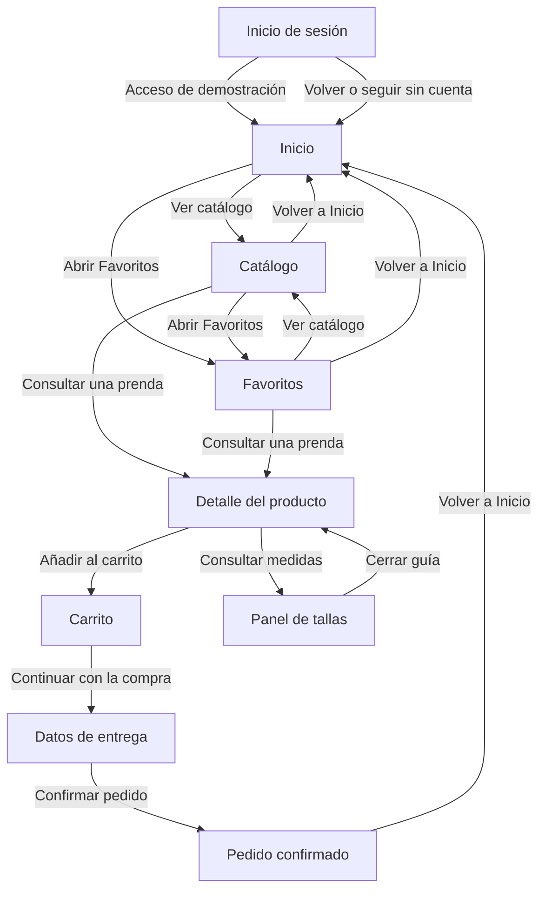

He separado el "Catálogo" del "Detalle" porque no se consulta la ropa de la misma manera en los dos sitios, en el "Catálogo" interesa comparar varias prendas y en la ficha hace falta centrarse en una para elegir el color y la talla, la guía queda dentro de esa elección, se abre sobre el "Detalle" y al cerrarla se vuelve a la prenda, así consultar las medidas no se convierte en otra parte de la tienda por la que haya que navegar desde cero, después aparece el "Carrito" como un momento de revisión antes de dar los datos de contacto y dirección

"Favoritos" no tiene la misma función que el "Carrito", guardar una chaqueta puede significar que gusta, pero todavía no se sabe si se va a comprar o qué talla hace falta, por eso he mantenido ambos espacios separados, la "Confirmación" termina el recorrido con el resumen y la vuelta a "Inicio", mientras que las flechas de las pantallas de compra permiten plantear el regreso al paso anterior, las versiones oscuras de "Inicio" y "Detalle" no añaden destinos al mapa, son las mismas pantallas con otra combinación de colores

He añadido "Inicio de sesión" como una octava pantalla, desde ella se puede entrar a la tienda o seguir sin cuenta, la he separado de los "Datos de entrega" porque acceder a una cuenta y escribir la dirección de un pedido son cosas distintas, el registro no se convierte en un paso obligatorio para mirar el "Catálogo" ni sustituye al formulario de la compra, en el mapa aparecen las salidas del login hacia "Inicio", los accesos de recuperar y crear cuenta se presentan dentro de esa pantalla, sin añadir recorridos que no están desarrollados en el prototipo

### 3.2 Wireframes

Los wireframes recogen la distribución de las ocho pantallas, he utilizado bloques para las imágenes y he conservado el texto de los botones para que se entienda qué se puede hacer antes de añadir las fotografías y los colores de la tienda, la versión del "Inicio de sesión" tiene la misma organización que su diseño final, predominan los grises, aunque el número de pedido conserva un pequeño tono azul en la "Confirmación"

#### Inicio

En "Inicio" he planteado dos formas de empezar, entrar por una categoría o ir a mirar el "Catálogo", esto responde a que algunas personas ya saben para qué edad están comprando y otras prefieren ver qué ropa hay antes de decidir, la ropa de temporada sirve para presentar el tipo de tienda y darle un contenido concreto a esa primera visita, pero sin ocupar tanto espacio que se pierdan los demás accesos, desde este primer diseño he mantenido la barra inferior como una referencia común, porque el contenido de temporada puede cambiar y los destinos principales de la app siguen siendo los mismos

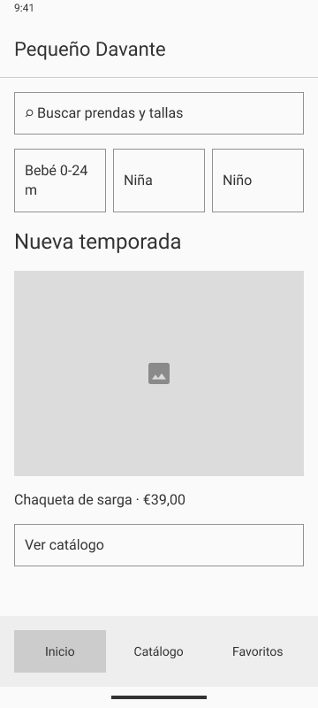

#### Catálogo

Para el "Catálogo" he elegido dos prendas por fila, así se pueden comparar varias opciones sin dejar las imágenes demasiado pequeñas, debajo de cada una aparece la información necesaria para esa primera elección, el nombre y el precio, he mantenido el mismo orden en las tarjetas para que resulte más fácil comparar sin ir buscando el coste en un lugar distinto cada vez, los filtros y la ordenación tienen su propio espacio porque afectan al conjunto de productos, mientras que cada tarjeta pertenece a una prenda, también he incluido la referencia de agotado para que la disponibilidad se conozca antes de entrar en una ficha

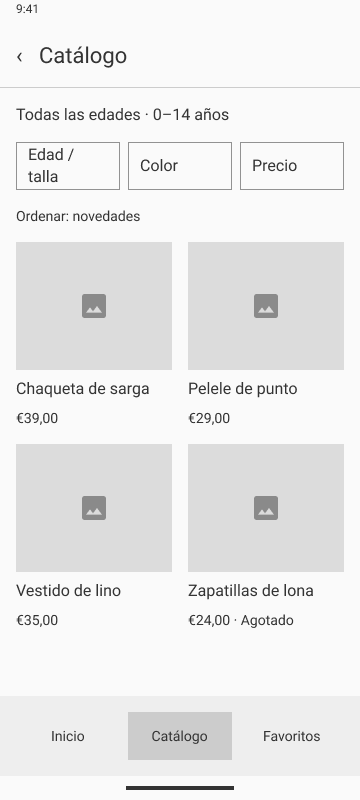

#### Detalle del producto

La ficha es donde la persona deja de comparar varias prendas y se centra en la que le interesa, he dado espacio a la imagen y a los datos del producto, pero también a la elección de talla, porque esa decisión es necesaria para añadirlo al "Carrito", la guía está cerca del selector para que se pueda consultar justo cuando surge la duda, en lugar de hacer que la persona salga a buscar ayuda por su cuenta, además, he diferenciado la talla sin stock de las disponibles, así el diseño explica desde el principio qué opciones se pueden elegir y cuál es el paso que viene después de la selección

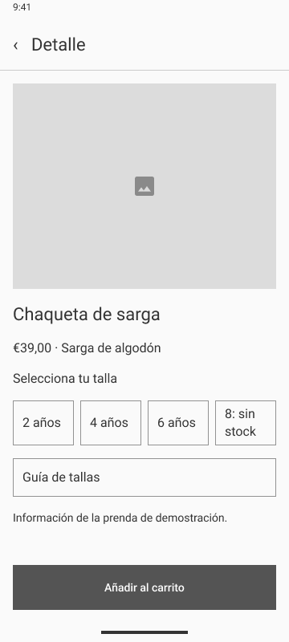

#### Carrito

En el "Carrito" he reunido lo que hace falta revisar antes de continuar, qué prenda se ha añadido, la talla, cuántas unidades hay y cuánto cuestan, el ejemplo muestra una chaqueta de talla 4, una unidad y 39 €, he dejado el cambio de cantidad y la eliminación relacionados con esa prenda porque modifican la selección, mientras que el resumen del importe pertenece a toda la compra, esta separación ayuda a distinguir entre cambiar algo de la cesta y pasar al siguiente paso, además permite comparar la cantidad elegida con el total antes de dedicar tiempo a rellenar la dirección

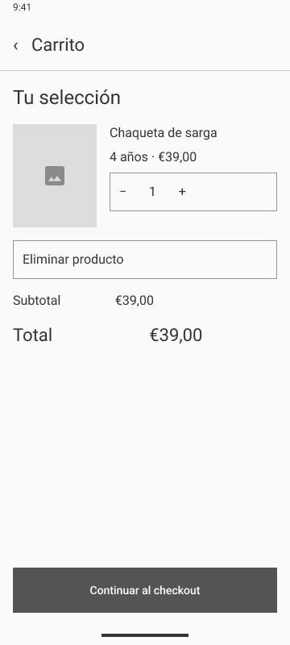

#### Datos de entrega

Para el formulario he seguido el orden de contacto y dirección, de esta forma los campos forman una secuencia que se puede completar sin ir saltando entre datos de distinto tipo, he mantenido el importe como referencia de la compra y he incluido el ejemplo de error del email con su ayuda, así desde el wireframe ya se tiene en cuenta qué ocurre cuando un dato no está bien escrito, la pantalla está centrada en los "Datos de entrega" de una compra simulada, no incluye una pasarela de pago ni pide datos de tarjeta, el siguiente paso del recorrido es la "Confirmación"

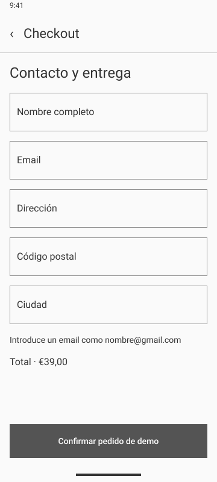

#### Pedido confirmado

Después de completar los datos, la persona necesita una respuesta que se pueda relacionar con lo que acaba de elegir, por eso la "Confirmación" incluye el resumen de la chaqueta, la talla 4, una unidad y 39 €, además del número de pedido de demostración 12-PD, un mensaje general de que todo ha ido bien no permitiría comprobar si la selección es la correcta, he mantenido esos datos para que el cierre tenga relación con el "Carrito" y he añadido Volver a "Inicio" como salida, así se puede regresar a la tienda después de terminar el recorrido

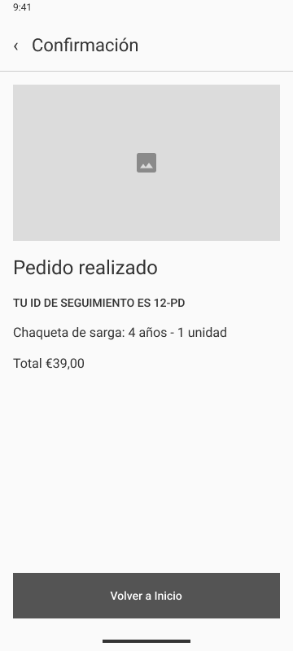

#### Favoritos

En "Favoritos" he reutilizado la forma de presentar los productos del "Catálogo" porque se siguen consultando las mismas prendas, lo que cambia es que aquí solo aparecen las que interesan, esta diferencia tiene sentido para alguien como Laura, que puede querer volver a mirar una chaqueta sin haber decidido todavía comprarla, el precio y la disponibilidad siguen siendo útiles en esa consulta, pero la elección de unidades y la revisión del importe se mantienen en el "Carrito", de esta forma guardar una prenda no se confunde con tener una compra preparada, y "Favoritos" conserva su lugar como tercer destino de la barra inferior

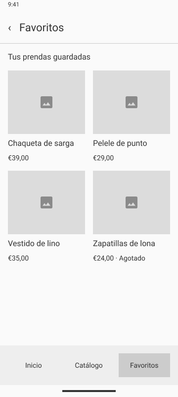

#### Inicio de sesión

En el wireframe del login he separado la identificación de la tienda del acceso a la cuenta, la marca y el espacio para la fotografía del centro quedan juntos, y después aparecen los campos de correo y contraseña, así la cabecera no se mezcla con lo que hay que rellenar, he dejado la recuperación cerca de la contraseña porque es donde tiene sentido buscarla si no se recuerda, la aceptación de los términos tiene su propio espacio antes de iniciar sesión y empieza sin marcar, también aparecen las alternativas de Google y cuenta Davante, cada una con una referencia a su icono, Crear cuenta queda separado del botón de acceso para distinguir a quien ya tiene cuenta de quien entra por primera vez, he conservado Seguir sin iniciar sesión como salida para poder consultar la tienda sin registrarse, en esta versión la foto se representa con un bloque gris y los botones mantienen la misma posición y tamaño que en el diseño final

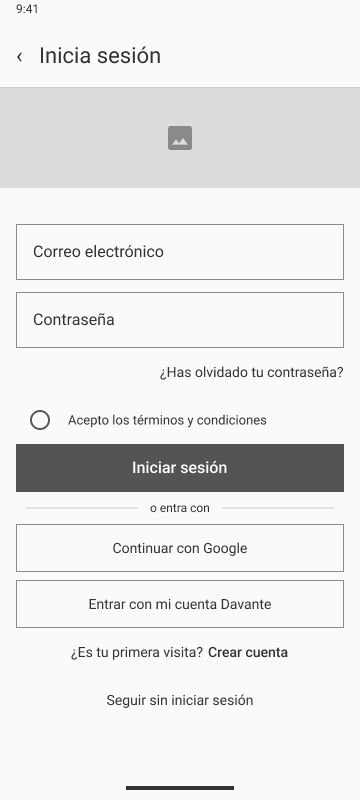

### 3.3 Guía de estilo Material Design 3

Para la guía de estilo he partido de la misma idea que da nombre a la tienda, mantener la relación con Davante y adaptarla a la ropa infantil, por eso he utilizado su referencia de azul y el logo, dejando que las fotografías aporten la variedad de las prendas, no he dado a cada pantalla una apariencia distinta porque eso haría que la app pareciera un conjunto de diseños separados, Material Design 3 me ha servido como base para organizar los botones, los campos y la navegación, y en esta guía recojo los colores, las medidas y los estilos de texto que he utilizado para mantener esa relación entre las pantallas

#### Color y contraste

El azul principal es #0234AB, lo he utilizado en las acciones y en la navegación para mantener la referencia de Davante, los fondos más suaves permiten separar el contenido sin quitar importancia a la ropa, además del azul secundario he incluido un coral como color de apoyo, así la interfaz tiene una paleta definida y las prendas pueden tener sus propios colores sin que todo compita por destacar, para las versiones oscuras he mantenido esa misma idea con un fondo azul muy oscuro y colores más claros en las acciones, cambia la combinación, pero se sigue reconociendo la tienda

| Uso | Claro | Oscuro |
| --- | --- | --- |
| Color principal | #0234AB | #AFC6FF |
| Texto sobre el principal | #FFFFFF | #06205F |
| Fondo de selección suave | #EAF1FC | #173A85 |
| Texto sobre esa selección | #082B65 | #EAF1FC |
| Color secundario | #2D5FAA | #ADC7F5 |
| Color de apoyo | #FF5B41 | #FFB49F |
| Fondo de pantalla | #F5F8FD | #101B30 |
| Texto principal | #17243D | #F0F4FC |

Al elegir los colores he tenido en cuenta que un fondo y el texto que va encima tienen que funcionar juntos, por ejemplo, en claro el botón principal combina el azul con texto blanco, pero en oscuro utiliza un azul más claro con texto oscuro, en Figma esta relación se reconoce en nombres como primary y onPrimary, el primero es el color del elemento y el segundo el del contenido que se coloca sobre él, he conservado esos nombres cuando aparecen en las tablas para que se puedan relacionar los valores del documento con los del archivo

He calculado el contraste de estas combinaciones a partir de los colores utilizados en las pantallas, tomando los valores completos, sin transparencias, la referencia mínima es 4,5 a 1, así puedo comprobar una pareja concreta de fondo y texto en vez de dar por hecho que se lee bien solo porque en mi pantalla parece suficiente

| Pantallas | Fondo y texto | Contraste |
| --- | --- | --- |
| Claras | #0234AB / #FFFFFF | 10,09 a 1 |
| Claras | #EAF1FC / #082B65 | 11,97 a 1 |
| Claras | #F5F8FD / #17243D | 14,55 a 1 |
| Oscuras | #AFC6FF / #06205F | 8,95 a 1 |
| Oscuras | #173A85 / #EAF1FC | 9,33 a 1 |
| Oscuras | #101B30 / #F0F4FC | 15,60 a 1 |

Las seis combinaciones superan esa referencia, pero eso no significa que se pueda poner cualquier texto sobre cualquier color de la paleta, hay que mantener las parejas para que el resultado siga siendo legible, además, he acompañado los estados con información escrita, por ejemplo, el email tiene un mensaje que explica el error y la talla agotada lleva su aviso de stock, así la persona no tiene que interpretar únicamente el rojo o la diferencia entre dos tonos para saber qué ocurre

También hay un tema llamado material-theme, con sus versiones clara y oscura, sus colores son diferentes de los azules del prototipo, así que los he recogido aparte para no mezclar dos paletas que no tienen los mismos valores, esta tabla muestra las doce parejas de ese tema y el contraste de cada una

| Esquema | Pareja | Color | Texto | Contraste |
| --- | --- | --- | --- | --- |
| Claro | primary / onPrimary | #65558F | #FFFFFF | 6,46 a 1 |
| Claro | primaryContainer / onPrimaryContainer | #EADDFF | #4F378B | 7,23 a 1 |
| Claro | secondary / onSecondary | #625B71 | #FFFFFF | 6,45 a 1 |
| Claro | tertiary / onTertiary | #7D5260 | #FFFFFF | 6,47 a 1 |
| Claro | surface / onSurface | #FEF7FF | #1D1B20 | 16,23 a 1 |
| Claro | error / onError | #B3261E | #FFFFFF | 6,54 a 1 |
| Oscuro | primary / onPrimary | #D0BCFE | #381E72 | 7,71 a 1 |
| Oscuro | primaryContainer / onPrimaryContainer | #4F378B | #EADDFF | 7,23 a 1 |
| Oscuro | secondary / onSecondary | #CCC2DC | #332D41 | 7,74 a 1 |
| Oscuro | tertiary / onTertiary | #EFB8C8 | #492532 | 7,75 a 1 |
| Oscuro | surface / onSurface | #141218 | #E6E0E9 | 14,35 a 1 |
| Oscuro | error / onError | #F2B8B5 | #601410 | 7,66 a 1 |

Las doce parejas del tema también superan 4,5 a 1, esos resultados corresponden a los colores de esta segunda tabla, la primera es la que describe las combinaciones azules de las pantallas, he mantenido la diferencia porque comprobar el contraste de un tema no demuestra que esos mismos colores estén aplicados en todo el diseño

Los valores están recogidos en [diseno/estilos.json](diseno/estilos.json), junto con los cinco estilos de texto y las medidas de distribución, he separado el esquema material-theme de la paleta de las pantallas porque cumplen funciones distintas dentro del archivo, el primero recoge los roles claros y oscuros del tema y la segunda conserva los azules que se ven en Pequeño Davante, el azul #0234AB identifica la propuesta, pero no lo presento como el origen comprobado de ese tema, así se puede consultar cada valor sin confundir la identidad de la tienda con la configuración incluida en Figma

Esta separación también ayuda a entender cómo se combinan los colores, una acción elegida utiliza su fondo y su texto correspondiente, mientras que una prenda agotada necesita conservar un aviso que explique por qué no se puede seleccionar, utilizar un azul de la paleta en cualquier lugar no garantiza que la opción se lea ni que su estado se entienda, por eso he relacionado el color con el significado del control y he comprobado parejas concretas de fondo y texto, en lugar de valorar solo si los colores quedan bien juntos

#### Tipografía y distribución

He utilizado Roboto y he cambiado el tamaño y el grosor según lo que explica cada texto, el nombre de una prenda necesita reconocerse antes que una descripción, y un botón necesita una etiqueta que se lea rápido, si todo tuviera el mismo tamaño y peso costaría más encontrar lo que interesa, por eso he seguido cinco estilos principales y he mantenido su función entre pantallas, de forma que un título o una acción no cambien de aspecto sin motivo al continuar la compra

| Nombre en Figma | Tamaño | Espacio entre líneas | Grosor | Para qué lo uso |
| --- | --- | --- | --- | --- |
| headlineSmall | 24 | 32 | Normal, 400 | Titulares como el de la temporada en "Inicio" |
| titleLarge | 22 | 28 | Normal, 400 | Nombre principal de la prenda en el "Detalle" |
| titleMedium | 16 | 24 | Medio, 500 | Información destacada como el precio |
| bodyLarge | 16 | 24 | Normal, 400 | Mensajes y textos de contenido |
| labelLarge | 14 | 20 | Medio, 500 | Etiquetas de botones y controles |

El espacio entre líneas también influye cuando un nombre o un mensaje ocupa más de una línea, si quedan demasiado juntas la lectura se hace incómoda, sobre todo desde el móvil, he mantenido las etiquetas de los botones cortas para que expliquen la acción sin ocupar un párrafo, hay otros tamaños para datos pequeños como la hora de la barra superior, pero los cinco de la tabla son los que organizan el contenido principal de la tienda

Para colocar el contenido he usado una rejilla de cuatro columnas con 16 de margen a cada lado y 8 entre columnas, en una pantalla de 360 de ancho esto deja 328 para trabajar, me sirve para alinear un campo, una tarjeta o un botón con el resto del contenido aunque tengan tamaños diferentes, tener cuatro columnas no significa que haya que mostrar cuatro prendas por fila, en el "Catálogo" he utilizado dos tarjetas porque así las fotos y los nombres tienen más espacio y se pueden comparar mejor

| Medida | Valor | Cómo la utilizo |
| --- | --- | --- |
| Tamaño de pantalla | 360 × 800 | Base común para los frames |
| Columnas | 4 | Referencia para alinear bloques |
| Margen lateral | 16 | Separación respecto al borde |
| Separación entre columnas | 8 | Espacio de la rejilla |
| Base de espaciado | 8 | Referencia para separar los elementos |
| Área mínima de pulsación que tomo como referencia | 48 × 48 | Espacio para tocar una acción |

He tomado 8 como base para las separaciones, así puedo utilizar espacios de 8, 16 o 24 dependiendo de si dos elementos forman parte del mismo grupo o si empieza otra parte del contenido, por ejemplo, la foto y el nombre de una prenda tienen una relación más cercana que esa tarjeta y el grupo de filtros, para las zonas de pulsación he tomado como referencia 48 × 48, esto se refiere al espacio que responde al tocar, no al tamaño del dibujo, un corazón puede verse pequeño y tener espacio alrededor para que no haya que acertar justo en el centro, algo que importa especialmente al usar la app con una mano

#### Componentes y estados

He mantenido una misma forma de presentar los elementos que se repiten, la cabecera sitúa la pantalla y la vuelta atrás, la barra inferior permite reconocer "Inicio", "Catálogo" y "Favoritos", y las tarjetas conservan el orden de foto, nombre y precio, en los campos del formulario la etiqueta y el mensaje de ayuda pertenecen al mismo dato, mientras que los botones principales indican acciones como continuar o añadir al "Carrito", esto evita que en cada pantalla haya que aprender otra forma de utilizar la tienda, la guía de medidas y el aviso con Deshacer completan las ayudas relacionadas con la elección y la revisión de una prenda

En las tarjetas y en los selectores he diferenciado varios estados manteniendo la misma estructura, una talla seleccionada no significa lo mismo que una talla sin stock, aunque las dos tengan un aspecto distinto al resto, del mismo modo, marcar una prenda como favorita no cambia su nombre ni su precio, he utilizado estas variantes para que se reconozca qué ha cambiado sin reorganizar todo el componente, la tabla recoge los estados que se necesitan distinguir

| Componente | Estados que necesito distinguir | Por qué los separo |
| --- | --- | --- |
| Tarjeta de producto | Normal, favorito y agotado | Una misma prenda puede interesar, estar guardada o no estar disponible |
| Selector de talla | Disponible, seleccionada y sin stock | Hay que diferenciar lo que se puede elegir de lo que ya está elegido |
| Selector de color | Normal, seleccionado y sin disponibilidad | El color elegido tiene que reconocerse dentro del grupo de opciones |
| Aceptación de términos del login | Sin marcar y aceptados | La aceptación empieza vacía y se puede cambiar, no se confunde con el botón de iniciar sesión |

La organización automática de los espacios, que en Figma se llama auto layout, ayuda a conservar la posición del contenido al reutilizar los componentes, así una tarjeta puede cambiar de nombre o de estado sin tener que colocar otra vez cada elemento a mano, lo importante es que esa reutilización mantenga también el significado de las opciones, en el selector la persona debe reconocer cuál ha elegido y cuál no puede comprar, no solo ver que algunos botones tienen otro color

En la página Componentes están los dos conjuntos locales de la propuesta, la tarjeta de producto y el selector de talla, las tarjetas del "Catálogo" y de "Favoritos" comparten el mismo componente, pero cada una conserva su fotografía, su nombre y su precio, con las tallas ocurre lo mismo, la base se repite y cambia la edad o el estado, he conectado once tarjetas y ocho selectores con estos componentes para mantener esa relación también dentro de Figma, los selectores de "Detalle" y de su versión oscura conservan sus colores y sus avisos de disponibilidad

### 3.4 Prototipo de alta fidelidad

En esta versión he llevado la distribución al aspecto final de Pequeño Davante, con el logo, los azules relacionados con Davante y las fotografías de las prendas, las ocho pantallas principales mantienen el formato de 360 × 800, el "Inicio de sesión" amplía el recorrido con una forma de acceder a la cuenta sin cambiar la compra como invitado, he buscado que la propuesta se reconozca como una misma tienda aunque cada pantalla tenga una función diferente, mirar ropa no necesita la misma información que revisar un "Carrito" o escribir una dirección

#### Inicio

Para la primera visita me interesaba que se entendiera qué vende la tienda y por dónde empezar, las categorías permiten entrar con una idea de la edad para la que se compra, mientras que el buscador ofrece una consulta más directa, he elegido la chaqueta de temporada para dar un ejemplo concreto de lo que se puede encontrar, con su precio y algunos detalles de la prenda, así la imagen tiene relación con una compra posible y no se queda como una decoración, las novedades amplían esa primera selección y Ver todo pertenece a ese grupo, mientras que Explorar el "Catálogo" da acceso a mirar más ropa, he separado esas acciones para que se entienda qué contenido se está consultando sin llenar el inicio de promociones distintas

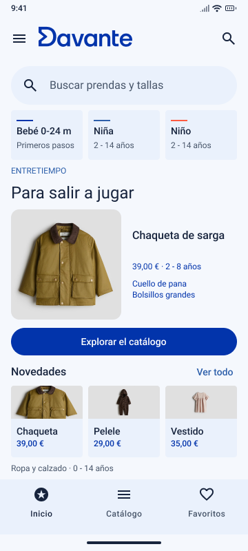

#### Catálogo

Al entrar en el "Catálogo" la necesidad cambia, aquí la persona quiere comparar varias prendas y decidir cuál le interesa abrir, he mantenido dos tarjetas por fila con el mismo orden de información para que la foto, el nombre y el precio se puedan consultar sin tener que aprender una tarjeta diferente cada vez, los filtros de edad o talla, color y precio permiten plantear una búsqueda más concreta, y la ordenación ofrece otra forma de comparar esos resultados, por ejemplo, buscar una talla y después mirar los precios no es la misma acción, el aviso de agotado en las zapatillas informa de la disponibilidad durante esa primera consulta, mientras que los corazones representan el interés por guardar una prenda, todavía sin elegir una talla ni añadir unidades a la compra

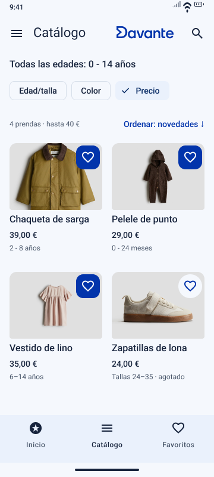

#### Detalle del producto

En la ficha he dado más espacio a la chaqueta porque ya no se está comparando todo el "Catálogo", se está decidiendo sobre esa prenda, la fotografía y la descripción permiten reconocer detalles como el cuello de pana y los bolsillos, y los indicadores de imagen representan la consulta de más fotografías, para las opciones he combinado el color con su nombre y su estado, Verde oliva aparece como Elegido y Arena como Sin stock, así la diferencia no depende solo de distinguir el tono o ver un borde, con las tallas he seguido la misma idea y la de 8 años lleva el aviso de agotada, la guía permite comparar medidas antes de elegir y el botón en estado Selecciona una talla explica qué falta para continuar, me parecía más claro mostrar esa condición que dejar un botón desactivado sin indicar el motivo

#### Carrito

He planteado el "Carrito" como una pausa para comprobar la selección antes de rellenar los datos, aquí interesa confirmar que se ha añadido la chaqueta correcta, que la talla es la elegida y que no hay una unidad de más, el ejemplo mostrado tiene una chaqueta verde oliva de talla 4, una unidad y 39 €, he diferenciado el precio de esa unidad del resumen de la cesta porque al aumentar la cantidad también cambia lo que cuesta la compra, además, el aviso de gastos de envío indica que todavía no están calculados, así el importe tiene una explicación, los pasos "Carrito", "Datos de entrega" y "Confirmación" sitúan a la persona dentro del recorrido, y la recuperación con Deshacer responde a un caso bastante normal, eliminar una prenda sin querer y necesitar recuperarla sin volver a buscarla en el "Catálogo"

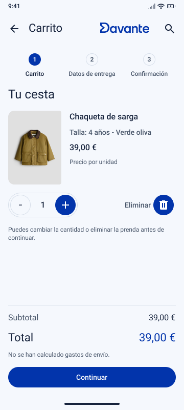

#### Datos de entrega

Al pasar al formulario he mantenido la referencia de los pasos y del importe para que se siga reconociendo la compra que se acaba de revisar, los datos se organizan por contacto y dirección, con una etiqueta que permite saber qué pertenece a cada campo incluso cuando ya tiene contenido, para el estado de error he utilizado el ejemplo de email marta@, acompañado de borde rojo, icono y un mensaje sobre el formato esperado, he elegido ese caso porque escribir algo en un campo no significa que el dato esté completo, la ayuda explica el fallo en el mismo sitio donde se corrige, en lugar de obligar a revisar todo el formulario buscando qué está mal, el prototipo representa esta entrega como parte de una compra simulada, sin enviar los datos ni realizar un pago real

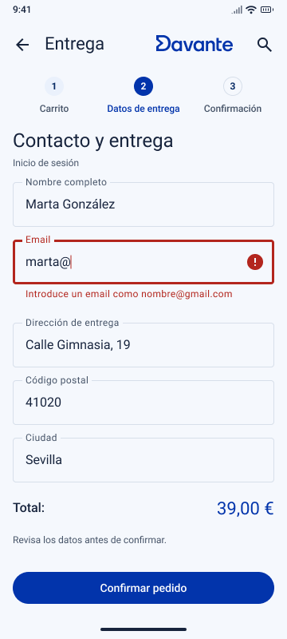

#### Pedido confirmado

La "Confirmación" debe permitir comprobar qué ha pasado después de continuar con los datos, por eso he acompañado Pedido realizado con el resumen de la selección y el número de demostración 12-PD, en esta pantalla aparecen la misma chaqueta, la talla 4, una unidad y 39 €, así la respuesta se puede relacionar con el "Carrito" y no se limita a un mensaje que serviría para cualquier compra, he dejado más espacio alrededor de la "Confirmación" porque aquí ya no se están comparando productos ni completando campos, lo que interesa es reconocer el resultado, Volver a "Inicio" ofrece una salida para regresar a la tienda una vez terminado el recorrido

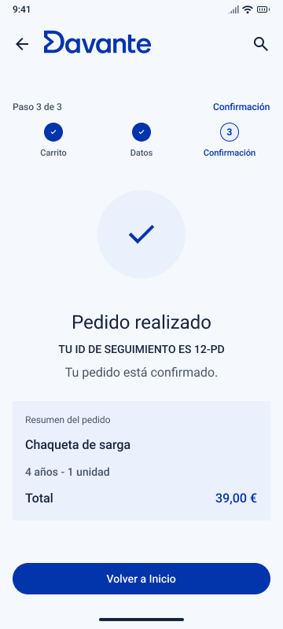

#### Favoritos

"Favoritos" está pensado para las prendas que gustan, aunque todavía no se haya decidido comprarlas, he utilizado las mismas tarjetas del "Catálogo" para reconocerlas sin cambiar la manera de consultar la foto, el nombre o el precio, en el ejemplo aparecen tres prendas y una ayuda sobre las tallas, esa ayuda tiene sentido en este momento porque guardar algo que gusta no resuelve si la medida será la adecuada, el "Carrito" sigue siendo el lugar para revisar las unidades y el importe de la compra, mientras que desde "Favoritos" se puede plantear volver a una prenda o seguir mirando con Explorar colecciones, he mantenido este destino en la barra inferior junto a "Inicio" y "Catálogo", y al pie aparece la palabra del día 29

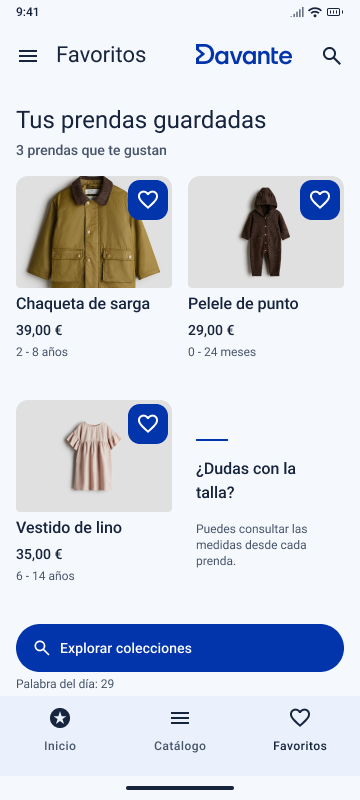

#### Inicio de sesión

El "Inicio de sesión" mantiene la idea de imaginar una tienda infantil de Davante, he colocado el logo en blanco sobre el azul de la marca y lo he acompañado de una fotografía de MEDAC Sevilla Este, la imagen relaciona esta parte del diseño con el centro y con el origen de la propuesta, mientras que Pequeño y Ropa infantil explican el uso que le he dado a esa identidad, la fotografía es una referencia del centro educativo, no representa una tienda de ropa real, he dejado la cabecera como una presentación breve para que los campos se vean sin tener que bajar por la pantalla, el nombre Inicia sesión permite reconocer desde el principio dónde se está

Para entrar con correo he mantenido una etiqueta en cada campo, de esta forma se distingue el correo de la contraseña aunque se escriba dentro, he relacionado la recuperación con la contraseña y he reservado un espacio propio a la aceptación de los términos y condiciones, el control es circular, como un radio button, empieza sin seleccionar y permite marcarlo o desmarcarlo, el botón Iniciar sesión lleva a "Inicio" en la demostración cuando se han aceptado los términos, esta condición representa la aceptación dentro del prototipo, no comprueba que el correo y la contraseña pertenezcan a una cuenta real, las etiquetas quedan completas sobre el borde del campo y el logo conserva espacio alrededor para que la marca se reconozca sin mezclarse con la fotografía

Google y la cuenta Davante aparecen como otras formas de acceso, he añadido el icono de cada servicio para reconocerlas antes de leer el botón y he mantenido el texto para que no haya que interpretar solo el dibujo, los dos accesos representan la entrada a la tienda dentro de Figma, sin conectar con cuentas externas, Crear cuenta permite distinguir el registro del acceso de una persona que ya tiene cuenta, tanto esa opción como la recuperación están representadas en el diseño, pero no tienen un formulario adicional, he mantenido Seguir sin iniciar sesión porque quien entra a buscar un regalo puede querer mirar las prendas antes de registrarse, la flecha de regreso ofrece otra forma de volver a "Inicio"

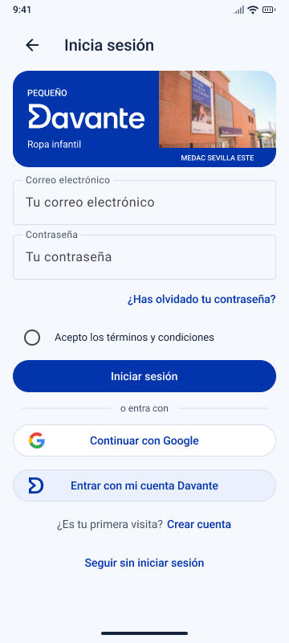

El [login en Figma](https://www.figma.com/design/uM6HT2RdelpEDSTGd4Fnk2/T1-Pequeno-Davante?node-id=46-723) y su [wireframe](https://www.figma.com/design/uM6HT2RdelpEDSTGd4Fnk2/T1-Pequeno-Davante?node-id=47-851) están en el archivo que incluye las ocho pantallas

#### Inicio y Detalle en oscuro

Para las versiones oscuras he conservado la misma organización de "Inicio" y "Detalle", la persona sigue encontrando la ropa y las opciones en su sitio, lo que cambia es la relación entre los colores de fondo y los del contenido, he utilizado un azul muy oscuro para mantener la referencia de Davante y tonos más claros para destacar las acciones, las fotografías siguen siendo las de las mismas prendas y el logo mantiene un fondo que permite reconocerlo, además, los estados de talla y color conservan sus etiquetas, porque elegido y sin stock significan lo mismo en los dos modos, no tendría sentido que cambiar la paleta obligara a interpretar otra vez cada opción

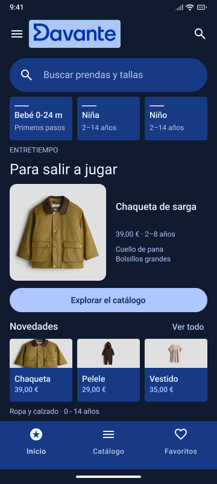

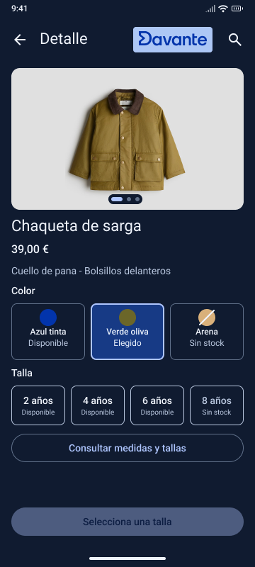

#### Guía de tallas

La guía es la ayuda que he relacionado más directamente con la compra de un regalo, saber que un niño tiene cuatro años puede orientar, pero no indica por sí solo qué prenda le va a quedar bien, por eso he incluido una figura, la indicación de medir sin apretar la cinta y una tabla para comparar las medidas, así la consulta tiene una referencia concreta y no se limita a otra lista de edades, las opciones Ropa y Calzado separan dos tipos de consulta y el ejemplo mostrado corresponde a ropa, la guía se abre sobre el "Detalle" y Cerrar guía permite volver a la prenda que se estaba mirando, de esta forma la ayuda sigue formando parte de la elección, teniendo en cuenta que es orientativa y no garantiza el ajuste de una talla

La tabla de referencia del panel procede de H&M y relaciona la edad con la altura y la referencia europea, la he utilizado como orientación dentro de la demostración, no como una tabla propia de medidas de Pequeño Davante, la procedencia aparece en la guía y queda recogida al final junto con las fotografías de producto, los precios y la disponibilidad mostrados en la app pertenecen al ejemplo de compra

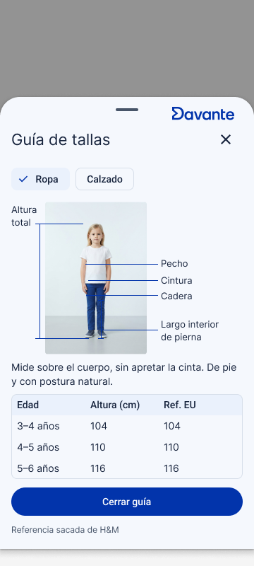

Entre el "Detalle" y el "Carrito" está configurada una transición Smart Animate de un cuarto de segundo, esta opción de Figma anima el cambio entre las pantallas y da continuidad al paso de elegir una prenda a revisar la cesta, la guía está configurada para abrirse sobre el "Detalle" y los componentes incluyen estados para representar las selecciones, estas son las interacciones definidas en el diseño, el recorrido completo se valora con las tareas de la prueba, diferenciando lo que se ve en una captura de lo que responde al pulsar

## 4. Validación y pruebas

### 4.1 Metodología

Para valorar el diseño he elegido tres tareas relacionadas con las decisiones principales de la compra, encontrar una prenda y revisar sus unidades, consultar una talla y corregir el email, la prueba está planteada con al menos dos compañeros de otro grupo, así se puede observar cómo utilizan la app personas que no han participado en su diseño, me interesa comprobar si entienden el recorrido sin explicarles antes dónde está cada botón, porque saber de antemano dónde pulsar haría que la prueba no sirviera para valorar si las acciones se encuentran por sí solas

| Tarea | Desde dónde empieza | Qué se considera completar la tarea |
| --- | --- | --- |
| Comprar la chaqueta verde oliva de talla 4 y dos unidades | "Inicio" | Llegar a "Pedido confirmado" con esa selección, cuyo importe esperado es de 78 € |
| Consultar las medidas de una talla | "Detalle del producto" | Abrir la guía, localizar la referencia de altura y volver a la prenda |
| Corregir el email del formulario | "Datos de entrega" con el email incorrecto | Corregir el dato y continuar hasta la "Confirmación" |

Los dos participantes tienen las mismas tareas y el mismo estado de partida, para que una selección de la persona anterior no cambie lo que encuentra la siguiente, la prueba recoge si cada tarea se termina, cuánto tiempo lleva y qué dificultades aparecen, he separado estas medidas porque llegar al final no explica por sí solo si el recorrido ha sido cómodo, alguien puede completar la compra después de varios intentos o necesitar ayuda para localizar la guía, y esa diferencia interesa para saber qué parte del diseño se entiende peor

| Medida | Qué se recoge |
| --- | --- |
| Éxito | Si la persona alcanza el resultado sin indicaciones sobre dónde pulsar |
| Tiempo | Segundos desde que empieza la tarea hasta que termina o la abandona |
| Errores | Elecciones equivocadas, entradas en otra pantalla o intentos fallidos |
| Ayuda | Qué indicación necesita para continuar y en qué momento |
| Observaciones | Dudas que expresa y diferencias entre lo que espera y lo que ocurre |

En el ejemplo del formulario, el email incorrecto es marta@ y al tocar el campo se activa una dirección de demostración con formato completo, he preparado ese cambio para representar la corrección y la desaparición del error, no es un campo que compruebe cualquier dirección escrita por la persona, por eso esta tarea sirve para observar si se reconoce el mensaje y se entiende cómo continuar, la validación de direcciones reales pertenece al desarrollo de la app

Los objetivos sirven para interpretar esos datos, por ejemplo, terminar una compra en más de dos minutos significa que se ha completado la tarea, pero no se ha alcanzado la meta de tiempo, también hay que diferenciar una equivocación de la persona de un control del prototipo que no responda al pulsar, en ese segundo caso el problema pertenece a la interacción, la guía y el email se consultan después del recorrido de compra, así que al valorar sus tiempos se tiene en cuenta que la persona ya ha visto esas pantallas, a partir de las dificultades observadas, la revisión se centra en tres hallazgos y en una mejora que se pueda comparar con el diseño anterior

### 4.2 Resultados

pruebas simuladas

Para esta revisión he utilizado los perfiles de David, de 29 años, y Laura, de 24 años, manteniendo el mismo punto de partida y las mismas tareas para los dos, cada recorrido empieza con el estado reiniciado para que la selección de una persona no cambie lo que encuentra la siguiente

| Persona | Tarea | Resultado | Tiempo | Errores | Ayuda |
| --- | --- | --- | --- | --- | --- |
| David | Comprar la chaqueta verde oliva de talla 4 y dos unidades | Completa y llega a "Pedido confirmado" con 78 € | 1 min 46 s | Entra primero en "Favoritos" antes de volver al "Catálogo" | No necesita ayuda |
| David | Consultar las medidas de una talla | Completa la consulta y vuelve al "Detalle" | 42 s | Pulsa primero sobre el texto de la talla antes de localizar "Consultar medidas y tallas" | Una indicación para buscar la ayuda en la ficha |
| David | Corregir el email del formulario | Corrige marta@ y continúa hasta la "Confirmación" | 36 s | Intenta continuar con el email incompleto | No necesita ayuda |
| Laura | Comprar la chaqueta verde oliva de talla 4 y dos unidades | Completa y llega a "Pedido confirmado" con 78 € | 1 min 32 s | Abre el selector de talla dos veces antes de añadir la prenda | No necesita ayuda |
| Laura | Consultar las medidas de una talla | Abre la guía, localiza la altura y vuelve al "Detalle" | 31 s | Ninguno | No necesita ayuda |
| Laura | Corregir el email del formulario | Corrige marta@ y continúa hasta la "Confirmación" | 28 s | Busca el botón de continuar antes de revisar el aviso del campo | No necesita ayuda |

Las dos personas terminan las tres tareas y alcanzan el resultado esperado, aunque David tarda algo más en la compra porque entra en "Favoritos" antes de seguir el recorrido principal, en la consulta de medidas la dificultad está en reconocer el acceso a la ayuda dentro del "Detalle", mientras que el mensaje del email permite localizar el campo que necesita corrección sin revisar todo el formulario

Los tres hallazgos más importantes son los siguientes

| Hallazgo | Qué afectaba al diseño | Cambio aplicado |
| --- | --- | --- |
| El acceso a las medidas podía confundirse con el nombre de una sección | La persona podía buscar una opción distinta para saber qué talla elegir | He cambiado "Guía de tallas" por "Consultar medidas y tallas" y he mantenido el acceso junto a los selectores |
| El recorrido de compra se entiende, pero "Favoritos" puede desviar a quien todavía está buscando una prenda | La navegación inferior ofrece varios destinos y no todos forman parte de la compra directa | He conservado los tres destinos, dejando las acciones de compra dentro de "Catálogo", "Detalle" y "Carrito" |
| El error del email se reconoce cuando aparece junto al campo | Un mensaje separado del formulario obligaría a buscar dónde está el problema | He mantenido el borde de error, el icono y el texto de ayuda en el propio campo |

La revisión del archivo también ha permitido comprobar la relación entre las pantallas, los estados de compra y los componentes que se repiten, las ocho pantallas principales conservan el tamaño de 360 × 800 y están acompañadas de las dos versiones oscuras y de la guía, las acciones de navegación no tienen destinos vacíos y la cantidad del pedido actualiza el resumen de 39 € a 78 €

### 4.3 Iteraciones y mejoras

He cambiado el acceso a la ayuda de la ficha de Guía de tallas a Consultar medidas y tallas, el primer texto nombraba el apartado, pero no explicaba tanto qué se podía encontrar al abrirlo, me interesa que alguien que busca un regalo entienda que puede comparar medidas y no solo consultar otra lista de edades, por eso he mantenido el acceso junto a los selectores y he cambiado únicamente su etiqueta, la ayuda sigue abriéndose sobre la misma prenda y conserva la tabla, la explicación para medir y el regreso al "Detalle", también he aplicado el texto en la versión oscura para que la misma acción no tenga dos nombres distintos

| Antes | Después |
| --- | --- |
| 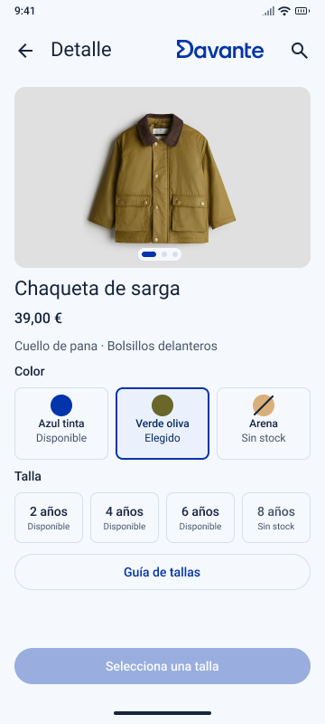 |  |

Las dos capturas muestran el cambio sobre la misma pantalla, el botón mantiene su espacio de 328 × 48 y la etiqueta completa cabe sin cortar el texto, he elegido esta mejora al revisar la relación entre la duda de talla y el acceso a la ayuda, no a partir de tiempos de participantes, su intención es hacer más comprensible la consulta, para saber si se encuentra antes hay que comparar el tiempo de apertura y los intentos de las personas que utilicen el prototipo

## 5. Entrega y documentación final

### 5.1 Justificación del diseño propuesto

La decisión que más ha marcado el diseño ha sido partir de una tienda ficticia de Davante y pensar cómo se adaptaría a la ropa infantil, de ahí salen el nombre Pequeño Davante, la relación con el logo y el uso del azul, he mantenido esa idea en las pantallas, pero dando más importancia a las prendas y a lo que necesita saber quien las compra, una app de este tipo puede tener una imagen reconocible y aun así resultar incómoda si no queda clara la talla o el importe, por eso he unido la identidad de la tienda con decisiones que tienen un motivo dentro de la compra

La talla es un ejemplo de esa relación, para quien compra habitualmente puede ser un dato conocido, pero para alguien que busca un regalo puede ser la principal duda, he colocado la guía en el "Detalle" para resolver esa consulta junto a la prenda y he diferenciado la talla elegida de la agotada, también he mantenido los nombres y los avisos de color para que la selección se entienda sin depender únicamente de distinguir tonos, la intención es que la persona pueda relacionar lo que le gusta con una opción que realmente pueda elegir

He separado la comparación, la elección y la revisión porque en cada momento hace falta información diferente, en el "Catálogo" se miran varias prendas, en el "Detalle" se decide la talla y el color, y en el "Carrito" se comprueba qué se ha añadido y en qué cantidad, así los "Datos de entrega" aparecen después de revisar la compra, el mensaje del email ayuda a corregir el dato dentro del propio formulario y la "Confirmación" vuelve a mostrar la selección para que se pueda reconocer el resultado, esta organización tiene sentido tanto para quien entra con una idea clara como para quien necesita consultar más antes de decidir

La misma forma de presentar las tarjetas, los botones y la navegación permite mantener esa organización al cambiar de pantalla, "Favoritos" reutiliza las prendas del "Catálogo" porque siguen siendo los mismos productos, aunque se estén guardando para mirarlos otro día, y las versiones oscuras conservan la distribución para que cambiar los colores no cambie la manera de utilizar la app, con todo esto he buscado que Pequeño Davante tenga una identidad propia y que las decisiones visuales se puedan explicar por cómo se compra, no solo por cómo queda una captura

### 5.2 Recomendaciones y pasos a seguir

Para llevar esta propuesta a una app real habría que conectar la selección con la información de los productos, por ejemplo, una talla sin stock debe corresponder a la disponibilidad de esa prenda y de ese color, y al cambiar las unidades el importe tiene que actualizarse junto con los gastos de envío antes de confirmar, he dado prioridad a estas operaciones porque afectan directamente a lo que la persona cree que va a comprar, también sería necesario guardar los "Favoritos" entre sesiones para que alguien como Laura pudiera cerrar la app y recuperar sus prendas otro día

En el formulario la ayuda tiene que responder a lo que se escriba, el ejemplo de email muestra un caso concreto, pero una app real necesita distinguir un campo vacío de una dirección incompleta y explicar cada error donde se corrige, además, al adaptar el diseño a otros móviles y al texto ampliado de Android hay que conservar el espacio de los controles y permitir que los mensajes se lean completos, para quien utilice un lector de pantalla también hace falta que la prenda, sus opciones y la ayuda se consulten en un orden que tenga sentido, de poco serviría que un botón se viera claro si no se pudiera reconocer su función de otra manera

Las siguientes mejoras del diseño deben relacionarse con lo que ocurra durante las pruebas, si cuesta encontrar la guía interesa revisar ese acceso, y si se confunde una talla seleccionada con otra agotada el cambio debe centrarse en sus estados, me parece más útil justificar una modificación con una dificultad concreta que añadir opciones porque sí, ampliar después las pruebas a personas que compran ropa infantil con frecuencia y a familiares que buscan regalos permitiría contrastar los perfiles con situaciones reales, manteniendo la misma idea de tienda y dando más detalle a los puntos que lo necesiten

## 6. Referencias bibliográficas

Davante MEDAC. (s. f.). *Davante MEDAC Sevilla Este*. <https://medac.es/fp-sevilla/calle-quimico-antonio-soto>

Google. (s. f.). *Tamaño de los objetivos táctiles*. Ayuda de Accesibilidad de Android. <https://support.google.com/accessibility/android/answer/7101858?hl=es>

Google. (2026, octubre 12). *Cómo hacer que las apps sean más accesibles*. Android Developers. <https://developer.android.com/guide/topics/ui/accessibility/apps?hl=es-419>

H&M. (s. f.-a). *Chaqueta en sarga encerada*. <https://www2.hm.com/es_es/productpage.1242006003.html>

H&M. (s. f.-b). *Guía de tallas*. <https://www2.hm.com/es_es/service-clients/sizeguide/sizing-faq.html>

H&M. (s. f.-c). *Pelele en punto de algodón*. <https://www2.hm.com/es_es/productpage.1099006019.html>

H&M. (s. f.-d). *Vestido de lino*. <https://www2.hm.com/es_es/productpage.1270521003.html>

H&M. (s. f.-e). *Zapatillas deportivas en mezcla de lino*. <https://www2.hm.com/es_es/productpage.1275418001.html>

Inditex. (2026, octubre 6). *Zara*. Google Play. <https://play.google.com/store/apps/details?hl=es&id=com.inditex.zara>

Kiabi. (s. f.). *Hacer un pedido en Kiabi.es*. <https://www.kiabi.es/servicios/pedido.html>

Kiabi. (2026, octubre 6). *KIABI, compras y moda online*. Google Play. <https://play.google.com/store/apps/details?hl=es&id=com.pictime.kiabi.activity>

Mayoral. (s. f.). *Camiseta volante niña Anís*. <https://www.mayoral.com/es/es/camiseta-volante-nina-anis-2603008074-5>

Mayoral Moda Infantil SAU. (2026, julio 30). *Mayoral - Moda infantil*. Google Play. <https://play.google.com/store/apps/details?hl=es&id=com.mayoral.appv2>

Vertbaudet. (s. f.). *Guía de calzado*. <https://www.vertbaudet.es/page/asesoramiento/guias/calzado.htm>

Zara. (s. f.). *Ayuda*. <https://www.zara.com/es/es/help/compra-segura-h28.html>

Palabra del día - 29
